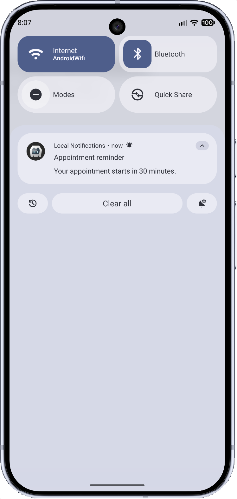
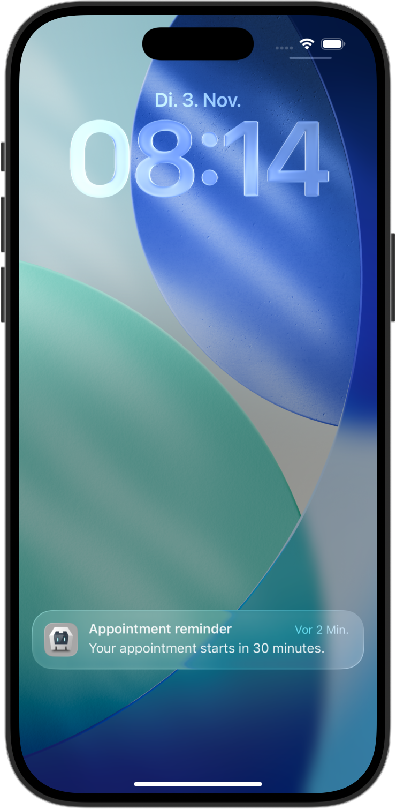

# Cordova Plugin Local Notifications — Continued


[)](https://npmjs.com/package/cordova-plugin-local-notifications-continued)
[)](https://github.com/GitToTheHub/cordova-plugin-local-notifications-continued)
<a href="https://opensource.org/licenses/Apache-2.0">
    
</a>

> [!NOTE]
> Since plugin version 1.2.4 (28th August 2026) this plugin will be continued to be maintained here. The original plugin [cordova-plugin-local-notifications](https://github.com/katzer/cordova-plugin-local-notifications) will not be maintained anymore.

Schedule local notifications on Android and iOS from your Cordova app. Local notifications are created on the device; they do not require a push notification server.

Notifications can display text, play a sound, update a badge, and offer action buttons. Their appearance and behavior depend on the platform, device capabilities, and the user's notification settings.

| Android 16 - Notification Drawer | iOS 26.5 - Notification Center |
| :--------- | :------- |
|  |  |

*Notifications created with this plugin in the Pixel 10 Pro emulator (Android 16) and iPhone 17 Pro simulator (iOS 26.5), with their complete original device frames. The screenshots show the notification drawer on Android and Notification Center on iOS. Android uses the plugin's default channel importance ([`IMPORTANCE_DEFAULT`](#property-androidchannelimportance)), without requesting a heads-up banner. Appearance varies by platform, device, and notification settings.*

## Contents

- [Installation](#installation) and [supported platforms](#supported-platforms)
- [Quick start](#basics)
- [Notification examples](#notification-examples): shared options and [one notification with platform-specific options](#one-notification-with-platform-specific-options)
- [Permissions](#permissions), [Android notification settings](#check-android-notification-settings), and [notification limits](#notification-limits)
- [Android behavior](#android-specials), [channels](#android-channels), and [exact alarms](#android-schedule-exact-alarms)
- [Actions](#actions), [triggers](#triggers), and [events](#events)
- [Troubleshooting](#troubleshooting)
- [Methods](#methods)
- [Property reference](#properties-1): [common](#common-properties), [Android](#android-properties), and [iOS](#ios-properties)
- [Upgrade notes](#upgrade-notice) and [renamed properties](#changed-properties)

The Promise API, channel query ([`getChannel()`](#getchannel)), `channel.enabled`, and channel-group APIs described below are available in **1.2.5-dev on GitHub**. They are not included in the 1.2.4 npm release.

### Supported Platforms

- Android 7.0+ (minimum version by cordova-android 13.0.0) with a minimum WebView Version 60 (Android 8 is shipped with a WebView version 58 and must be updated with Google Play Store before)
- iOS 11.3+ (minimum version by cordova-ios 7.0.0)

The examples use Promises with `async` / `await`. This syntax is supported from **Android WebView 55** and **iOS 10.3**, so it is covered by the plugin's minimum versions above. On Android, JavaScript syntax support depends on the installed WebView version, not just the Android version. See [MDN: await compatibility](https://github.com/mdn/browser-compat-data/blob/main/javascript/operators/await.json) and [WebKit: Safari 10.1 and iOS 10.3](https://webkit.org/blog/7477/new-web-features-in-safari-10-1/).

Use `await` inside an `async` function, as shown in [Quick Start](#basics). The examples do not require top-level `await` (outside a function), which has different compatibility requirements.

### Installation

#### NPM

##### Since Version 1.2.4

```bash
cordova plugin add cordova-plugin-local-notifications-continued
```

Install a specific version:

```bash
cordova plugin add cordova-plugin-local-notifications-continued@1.2.4
```

##### Version Older Than 1.2.4 (Original From [katzer/cordova-plugin-local-notifications](https://github.com/katzer/cordova-plugin-local-notifications))

```bash
cordova plugin add cordova-plugin-local-notification@1.2.3
```

#### GitHub

Install the latest development version from GitHub:

```bash
cordova plugin add https://github.com/GitToTheHub/cordova-plugin-local-notifications-continued
```

Install from a tag:

```bash
cordova plugin add https://github.com/GitToTheHub/cordova-plugin-local-notifications-continued#v1.2.4
```

Install from a specific commit:

```bash
cordova plugin add https://github.com/GitToTheHub/cordova-plugin-local-notifications-continued#5e4f131
```

<a id="basics"></a>
## Quick Start

Wait for Cordova's `deviceready` event before using `cordova.plugins.notification.local`.
Check the current notification permission before scheduling so your app can respond if notifications are disabled. Users can revoke permission in system settings at any time; do not assume that an earlier grant still applies. This example uses [`requestPermission()`](#requestpermission) to check the current app-level permission and request it when the system allows a prompt.

```js
document.addEventListener('deviceready', async () => {
    try {
        const notifications = cordova.plugins.notification.local;

        // Check the current app-level permission; the user may have revoked it.
        // Request permission if needed and handle a denial before scheduling.
        const granted = await notifications.requestPermission();
        if (!granted) {
            console.log('Notification permission was not granted.');
            return;
        }

        await notifications.schedule({
            id: 1,
            title: 'My first notification',
            text: 'Your reminder is ready.',
            trigger: { in: 5, unit: 'second' }
        });
    } catch (error) {
        console.error('Notification operation failed:', error);
    }
}, false);
```

On Android, app-level permission does not tell you whether an individual channel is blocked. For apps that rely on reminders, also check the selected channel as shown in [Check Android Notification Settings](#check-android-notification-settings).

The trigger requests delivery after five seconds. Android may deliver it later when exact alarms are not permitted; see [exact alarms](#android-schedule-exact-alarms).

[`schedule()`](#schedule) also checks and requests app-level permission automatically. The explicit check above lets your app explain a denial and offer a way to open settings before attempting to schedule. It does not check whether an individual Android channel is blocked. Request permission at a point where the user understands why your app needs it. See [Permissions](#permissions).

Give each notification a unique numeric [`id`](#property-id). If omitted, the ID defaults to `1`; reusing an ID replaces the previous notification with that ID.

Without a [`trigger`](#triggers), the plugin requests immediate delivery:

```js
async function quickStartExample() {
    try {
        await cordova.plugins.notification.local.schedule({
            id: 2,
            title: 'Ready now',
            text: 'Your download is complete.'
        });
    } catch (error) {
        console.error(error);
    }
}

quickStartExample();
```

To schedule several notifications, pass an array:

```js
async function quickStartExample2() {
    try {
        await cordova.plugins.notification.local.schedule([
            { id: 3, title: 'First reminder', trigger: { in: 1, unit: 'minute' } },
            { id: 4, title: 'Second reminder', trigger: { in: 2, unit: 'minute' } }
        ]);
    } catch (error) {
        console.error(error);
    }
}

quickStartExample2();
```

### Check Android Notification Settings

Use this check when revisiting notification settings, for example after the app resumes. It checks a channel your app already uses. This example assumes that the [Quick Start](#basics) has successfully scheduled a notification and created `default_channel`. If your app uses a custom channel, use that existing channel's [`androidChannelId`](#property-androidchannelid) instead.

Android 7 has no notification channels, so only app-level settings are checked there. On Android 8 and newer, [`getChannel()`](#getchannel) combines app-level and channel-level blocking in `channel.enabled`. On Android 9 and newer, it also includes channel-group blocking.

```js
try {
    // Run inside an async function after deviceready.
    if (cordova.platformId !== 'android') return;

    const notifications = cordova.plugins.notification.local;
    const androidVersion = parseInt(device.version, 10);

    if (androidVersion < 8) {
        const enabled = await notifications.hasPermission();
        console.log('Android 7 app notifications enabled:', enabled);
        return;
    }

    // The default channel was created by the Quick Start notification.
    const channelId = 'default_channel';
    const channel = await notifications.getChannel(channelId);
    if (channel === null) {
        console.warn('Expected an existing channel. Check the channel ID and notification setup:', channelId);
        return;
    }

    if (!channel.enabled) {
        console.log('Notifications are blocked by app, channel, or channel-group settings. Please review Android notification settings.');
        return;
    }

    console.log('Notifications are enabled for this channel.');
} catch (error) {
    console.error(error);
}
```

The version check uses `device.version` from `cordova-plugin-device`, a dependency of this plugin. Read it after `deviceready`.

**A missing channel is not a permission result.** In Android's notification settings, users can disable individual channels, but cannot delete them. A disabled channel still exists and returns `enabled: false`. In this example, `null` therefore indicates an unexpected missing channel: check the ID, whether the initial scheduling completed, or whether your app deleted the channel with [`deleteChannel()`](#deletechannel). Do not treat `null` as permission denial or ask the user to grant permission because of it.

`channel.enabled` includes the app-level status, so a separate [`hasPermission()`](#haspermission) call is unnecessary on Android 8 and newer. The fields `appNotificationsEnabled`, `blocked`, and `groupBlocked` explain the individual reasons; see [getChannel](#getchannel). An enabled channel does not guarantee sound, exact timing, or delivery in every device mode. Offer [openNotificationSettings](#opennotificationsettings) when the user wants to change their settings.

## Notification Examples

Run these examples after `deviceready`. Each example is independent. They show common combinations; you do not need to specify every option. Omitted options use the [default values](#default-values).

### Shared Options Example

This example uses properties supported on both Android and iOS:

```js
async function sharedOptionsExampleExample() {
    try {
        await cordova.plugins.notification.local.schedule({
            id: 10,
            title: 'Appointment reminder',
            text: 'Your appointment starts in 30 minutes.',
            trigger: { in: 30, unit: 'minute' },
            sound: 'default',
            launch: true,
            data: { appointmentId: 'appointment-42' }
        });

        cordova.plugins.notification.local.on('click', (notification) => {
            console.log('Open appointment:', notification.data.appointmentId);
        });
    } catch (error) {
        console.error(error);
    }
}

sharedOptionsExampleExample();
```

`data` carries your own application data; it is not displayed in the notification. Use it to decide what to open when the user taps the notification. See [common properties](#common-properties), [triggers](#triggers), and [events](#events).

### One Notification With Platform-Specific Options

Combine shared content and conditional platform options in a single [`schedule()`](#schedule) call. Object spread (`...`) includes only the options for the current platform:

```js
async function oneNotificationWithPlatformSpecificOptionsExample() {
    try {
        await cordova.plugins.notification.local.schedule({
            id: 15,
            title: 'Appointment reminder',
            text: 'Your appointment starts in 30 minutes.',
            trigger: { in: 30, unit: 'minute' },
            sound: 'default',
            launch: true,
            data: { appointmentId: 'appointment-42' },

            ...(cordova.platformId === 'android' ? {
                androidChannelId: 'appointment_reminders',
                androidChannelName: 'Appointment reminders',
                androidChannelImportance: 'IMPORTANCE_DEFAULT',
                androidAutoCancel: true,
                androidColor: '#1565C0'
            } : {}),

            ...(cordova.platformId === 'ios' ? {
                iOSForeground: true,
                badgeNumber: 1
            } : {})
        });
    } catch (error) {
        console.error(error);
    }
}

oneNotificationWithPlatformSpecificOptionsExample();
```

> [!NOTE]
> Object spread in `{ ...options }` requires Android WebView 60 or newer and iOS 11.3 or newer, matching the minimum versions listed in [Supported Platforms](#supported-platforms). Android 7 devices with an older, non-updated WebView may not understand this syntax; use `Object.assign()` instead if your application needs to support them. The plugin uses `Object.assign()` internally in some places for this compatibility reason. Rest parameters such as `function (event, ...args) {}` are a different JavaScript feature with earlier support; their presence in the plugin does not imply support for object spread. See [MDN: Spread Syntax](https://developer.mozilla.org/en-US/docs/Web/JavaScript/Reference/Operators/Spread_syntax#browser_compatibility).

Both platforms use the same ID, title, text, trigger, and application data. Android adds channel and appearance settings; iOS adds foreground presentation and badge settings. Only the current platform's options are passed to the plugin, avoiding warnings about unknown properties. [`badgeNumber`](#property-badgenumber) is shared by both platforms, but this example deliberately sets it only on iOS because its behavior differs by platform.

On Android 8 and newer, channel settings control sound, vibration, and importance for all notifications using that channel. [`schedule()`](#schedule) creates the selected channel if needed; without channel properties, it uses the [default channel](#default-channel). You do not need to call [`createChannel()`](#createchannel) first. Reusing a channel ID does not reset its settings, which the user can change in Android's system settings. See [Android Channels](#android-channels) for details, including separate channel creation. Android 7 has no notification channels; applicable settings are applied to individual notifications.

On iOS, [`iOSForeground`](#property-iosforeground) allows a banner while the app is open. `badgeNumber: 1` sets the badge to one rather than incrementing it. Vibration cannot be configured independently of sound. See [iOS Properties](#ios-properties), [badgeNumber](#property-badgenumber), and [sound](#property-sound).

For other notification types, see [action buttons and text input](#actions), [images and attachments](#property-attachments), [progress indicators](#progress), [message summaries](#summarizing), and [grouping](#grouping). These features are documented separately because they are not all applicable to the same notification.

## Notification Limits
The number of pending notifications is limited by the platform:

- iOS: 64
- Android: 500

A repeating notification counts as one pending notification.

<a id="properties"></a>
## Choosing Notification Options

Start with [`id`](#property-id), `title`, and `text`, then add a [`trigger`](#triggers) for delayed or repeating delivery.

- [Common properties](#common-properties) are supported on both platforms, although behavior can differ.
- [Android properties](#android-properties) configure Android channels, appearance, and delivery behavior.
- [iOS properties](#ios-properties) configure iOS-specific behavior.
- [Available properties](#available-properties) explain individual options in more detail.

Use the current property names in new code. If you are adapting an older example, check [Changed properties](#changed-properties).

## Permissions

On iOS and Android 13 or newer, the user must allow notifications before your app can post them. [`schedule()`](#schedule) requests this permission automatically. You can also call [requestPermission](#requestpermission) explicitly, as shown in the [quick start](#basics).

### Recheck Permission After Settings Changes

A previous grant is not permanent. Users can disable notifications later, including while your app is in the background. Do not rely on a permanently cached permission result.

Choose the method according to what your app is doing:

- **Enabling or scheduling reminders:** call [requestPermission](#requestpermission) directly and handle its result, as shown in the [Quick Start](#basics). You do not need to call [`hasPermission()`](#haspermission) first. If permission is already granted, no new dialog is needed.
- **Displaying the current permission status:** use [hasPermission](#haspermission) to check without requesting permission. For example, refresh a status indicator when your app resumes after the user visits system settings.

[`schedule()`](#schedule) already checks and requests app-level permission automatically. An explicit [`requestPermission()`](#requestpermission) call lets your app respond to a denial before attempting to schedule, for example by explaining how to enable notifications in settings.

The following example only reads the status when the app resumes; it does not request permission. Register the listener after `deviceready`:

```js
document.addEventListener('resume', async () => {
    try {
        const granted = await cordova.plugins.notification.local.hasPermission();
        // Update your app's permission status indicator.
        console.log('Notifications allowed:', granted);
    } catch (error) {
        console.error('Notification operation failed:', error);
    }
}, false);
```

The system decides whether to show a permission dialog. Calling [`requestPermission()`](#requestpermission) does not guarantee another prompt if the user has already made a choice. Users can change permissions later in system settings; see [openNotificationSettings](#opennotificationsettings).

| Android | iOS |
| :------ | :-- |
|  |  |

### Android: App Permission and Channel Settings

Android has two separate levels of notification control:

- **App level:** users can disable notifications for the entire app. On Android 13 and newer, this includes the `POST_NOTIFICATIONS` runtime permission. Earlier Android versions also allow notifications to be disabled in system settings.
- **Channel level (Android 8 and newer):** users can block an individual channel or change its sound, vibration, and importance while leaving notifications enabled for the app. See [Android channel settings](https://developer.android.com/develop/ui/views/notifications/channels).

**App and channel checks are separate:** [`hasPermission()`](#haspermission) and [`requestPermission()`](#requestpermission) check the app-level status. On Android they use `areNotificationsEnabled()`; they do not inspect a specific channel. Use [getChannel](#getchannel) to read the channel's current settings, including whether the channel or its group is blocked. App-level permission alone does not guarantee that a notification on a particular channel will be displayed or make a sound.

If reminders are missing despite app-level permission being granted, ask the user to check the relevant channel in Android's notification settings. [openNotificationSettings](#opennotificationsettings) opens the app's notification settings; it does not automatically re-enable a blocked channel.


For platform details, see [Android notification permission](https://developer.android.com/develop/ui/views/notifications/notification-permission) and [Apple: Asking permission to use notifications](https://developer.apple.com/documentation/usernotifications/asking-permission-to-use-notifications).

Notification permission and Android's **exact alarm permission** are separate. Notification permission allows your app to display notifications; exact alarm permission affects when scheduled notifications can be delivered. See [exact alarms](#android-schedule-exact-alarms).

## Troubleshooting

| Problem | What to check |
| :------ | :------------ |
| `cordova.plugins.notification.local` is unavailable | Install the plugin, rebuild the native app, and wait for `deviceready`. The plugin supports Android and iOS, not a regular browser page. |
| A notification does not appear | Check [notification permission](#permissions), system notification settings, and the selected Android channel. Make sure the trigger is not in the past. |
| A reminder arrives later than requested on Android | Check [exact alarm permission](#android-schedule-exact-alarms), [Doze](#doze-and-standby), and battery restrictions. Notification permission alone does not enable exact timing. |
| A notification replaces an earlier one | Give each notification a unique numeric [ID](#property-id). The default is `1`. |
| Changing sound or vibration has no effect on Android | Check whether the [channel](#android-channels) already exists. New values do not reset an existing channel's settings. |
| No banner appears while the app is open on iOS | Check [iOSForeground](#property-iosforeground) and the user's notification settings. |
| iOS action buttons are not visible | Press and hold the notification to expand it. See [Actions](#actions). |
| A custom image or sound cannot be found | Check the property's supported platforms and [resource patterns](#resource-resolving). |

## Android Specials

### Notification Channels
Android 8 and newer require a channel for each notification. The plugin creates a [default channel](#default-channel) if you do not specify one. Create your own channel with [createChannel](#createchannel) or by [scheduling a notification with channel properties](#create-channel-by-posting-a-notification). Use [deleteChannel](#deletechannel) to remove a channel. See the [combined platform example](#one-notification-with-platform-specific-options) for the complete flow.

### Inexact Alarms Since Android 12
Since Android 12 alarms will be scheduled inexact by default. On Android 12 (API level 31) and higher, the system invokes the alarm within one hour of the supplied trigger time, unless any battery-saving restrictions are in effect such as battery saver or Doze. Most apps can schedule tasks and events using inexact alarms to complete several common use cases. If your app's core functionality depends on a precisely-timed alarm — such as for an alarm clock app or a calendar app — then it's OK to use an exact alarm instead.

See [Schedule exact alarms](#android-schedule-exact-alarms), if you want use exact alarms.

See [Android documentation](https://developer.android.com/develop/background-work/services/alarms/schedule) for more information.

### App Hibernation / App Unused
If your app runs on Android 12 and newer and the user doesn't interact with your app for 3 months, the system places your app in a hibernation state which will cancel all pending notifications and revokes permissions. When the user interacts with your app again, the app exits hibernation and the notifications will be re-scheduled. It doesn't count as app usage if the user dismisses a notification. If the app is hibernated, the user will get informed about it:


The documentation says that permissions are also revoked, but testing the hibernation behavior on an Android 15 emulator showed, that the app keeps the permission to post notifications.

#### Notes
- Android introduced this behavior in Android 11 and additionally backported this to Android 6 to 10 through the Google Play Store but only the permissions are revoked and not the pending notifications. Because permissions are only needed since Android 13, this does not affect this plugin. Since Android 12 notifications are also canceled besides revoking the permissions.
- You can manually test the hibernation behavior, see [App hibernation > Manually invoke hibernation behavior](https://developer.android.com/topic/performance/app-hibernation#manually-invoke).
- To see a complete list, what counts as app usage and what not, see [App hibernation > App usage](https://developer.android.com/topic/performance/app-hibernation#app-usage).
- 3 months are based on executing `adb shell device_config get permissions \ auto_revoke_unused_threshold_millis2` which will return `7776000000` milliseconds on an Android 15 Emulator which are nearly 3 months (~2.96 months).

#### Manage App Hibernation

You can get the status of the setting by calling [getUnusedAppRestrictionsStatus](#getunusedapprestrictionsstatus). To redirect the user to the setting, call [openManageUnusedAppRestrictions](#openmanageunusedapprestrictions). Before opening the setting, you can inform the user about this behavior and explain which setting he has to deactivate. When opening the settings, the system will not scroll to the right entry and the setting is named differently on different Android versions:

Sample Android 12:


On other Android versions it is named differently:

Android 13/14:


Android 15:


### Doze and Standby

Android has two power-saving features that extend battery life for users by managing how apps behave when a device isn't connected to a power source: Doze and App Standby. Doze reduces battery consumption by deferring background CPU and network activity for apps when the device is unused for long periods of time. App Standby defers background network activity for apps with no recent user activity.

To fire notifications when the device is in doze mode, you can schedule notifications with the property [androidAllowWhileIdle](#property-androidallowwhileidle).

App Standby does not affect you when showing a notification.

You can read everything about it in the [Android documentatation](https://developer.android.com/training/monitoring-device-state/doze-standby).

### Alarm Rescheduling

#### App Update
Android removes all alarms when the app is updated. The plugin reschedules all alarms by a [BroadcastReceiver](https://developer.android.com/develop/background-work/background-tasks/broadcasts) listening to [ACTION_MY_PACKAGE_REPLACED](https://developer.android.com/reference/android/content/Intent#ACTION_MY_PACKAGE_REPLACED).

#### Device Reboot

Android removes all alarms when the device reboots. The plugin reschedules all alarms by a [BroadcastReceiver](https://developer.android.com/develop/background-work/background-tasks/broadcasts) listening to [ACTION_BOOT_COMPLETED](https://developer.android.com/reference/android/content/Intent#ACTION_BOOT_COMPLETED), but only after the device has been unlocked.

#### User Grants Exact Alarms

If you use [SCHEDULE_EXACT_ALARM](#exact-alarms-user-grants-permission) for scheduling exact alarms and the user permits the permission in the "Alarms & Reminders", inexact alarms will be rescheduled as exact alarms. This is done by a [BroadcastReceiver](https://developer.android.com/develop/background-work/background-tasks/broadcasts) listening to [ACTION_SCHEDULE_EXACT_ALARM_PERMISSION_STATE_CHANGED](https://developer.android.com/reference/android/app/AlarmManager#ACTION_SCHEDULE_EXACT_ALARM_PERMISSION_STATE_CHANGED). This action will not be called if the user revokes the permission. All exact alarms will be canceled then.

#### Android 15: Alarms Get Canceled on `Force stop`
Since Android 15 all pending alarms will get canceled if the user force stops an app, this is a change by Google, see https://developer.android.com/about/versions/15/behavior-changes-all#enhanced-stop-states. The alarms will be re-registered, if the user starts the app again. If the user clears the app from the app stack the alarms will not get canceled.

Keep in mind, that force stopping is only known by advised users and if they do it, they have a reason to do this and they should be aware, that the app will no longer function correctly as the System also states when clicking on `Force stop` by showing an alert with the message `If you force stop an app, it may misbehave.`

## Actions

You can add actions to a notification, which can be a button or an input.
Before you can use them you have to create an action group with some actions.

```js
async function actionsExample() {
    try {
        // Creates an action group with the id 'YES_NO_CATEGORY' and two actions.
        await cordova.plugins.notification.local.addActions('YES_NO_CATEGORY', [
            {
                id: 'YES_ACTION', // Action id
                title: 'Yes', // Action button title
                launch: true // Click on action will open the app
            },
            {
                id: 'NO_ACTION',
                title: 'No'
            }
        ]);
    } catch (error) {
        console.error(error);
    }
}

actionsExample();
```

To see which properties can be set see [Action properties](#action-properties).

By default a click on an action will not open the app. To launch the app when a notification was clicked, set `launch: true`.

Note for Android: If `launch` is not set and the app is killed, the event will be hold back in a background process of the app to wait for the next time the app starts, but could be lost, if the system kills the app background process.

If the `type` of an action is not set, it defaults to `button`.

After the action group is defined, you can assign it to a notification:

```js
async function actionsExample2() {
    try {
        await cordova.plugins.notification.local.schedule({
            id: 1,
            title: 'Justin Rhyss',
            text: 'Do you want to go see a movie tonight?',
            actions: 'YES_NO_CATEGORY'
        });
    } catch (error) {
        console.error(error);
    }
}

actionsExample2();
```

<p style="text-align: center;">
    
    
</p>

On iOS the actions are not visible by default. You have to long press on the notification to see them.

### Action Input

Create an action group with an action input:

```js
async function actionInputExample() {
    try {
        await cordova.plugins.notification.local.addActions('REPLY_NO_CATEGORY', [
            {
                id: 'REPLY_ACTION',
                type: 'input',
                title: 'Reply',
                emptyText: 'Type message',
                launch: true // Will open the app
            },
            {
                id: 'NO_ACTION',
                title: 'No'
            }
        ]);
    } catch (error) {
        console.error(error);
    }
}

actionInputExample();
```

To see which properties can be set for an action input see [Action properties](#action-properties).

Schedule notification with the defined action group:

```js
async function actionInputExample2() {
    try {
        await cordova.plugins.notification.local.schedule({
            id: 1,
            title: 'Justin Rhyss',
            text: 'Do you want to go see a movie tonight?',
            actions: 'REPLY_NO_CATEGORY'
        });
    } catch (error) {
        console.error(error);
    }
}

actionInputExample2();
```

| iOS          | Android      |
| :----------- | :----------- |
|  | <br> |

#### Read Input Data

You have to subscribe to the event of the action id. The parameter `event` in the event callback will contain the input data of the user:

```js
cordova.plugins.notification.local.on('REPLY_ACTION', (notification, event) => {
    // User made an input, event.text contains the input
    console.log("user input data=" + event.text);
});
```


##### Android Specifics

When a notification has an input action, it can't be cleared from the statusbar (see
[Stackoverflow](https://stackoverflow.com/questions/54219914/cancel-notification-with-remoteinput-not-working) or [plugin issue #2080](https://github.com/katzer/cordova-plugin-local-notifications/issues/2080)).
Google recommends to update the notification after the user made an input and show the reply without the actions. This plugin does this, but without showing the reply of the user and directly clear the notification after the update. Because the notiification will be updated after the input, you will get also an [`update`](#methods) event for that notification.

### Handle Action Events

See [Subscribe to an action event](#subscribe-to-an-action-event).

### Action Properties

#### Common

These common properties can be specified for an action of type `button` or `input`:

| Property     | Android | iOS | Description |
| :----------- | :------ | :-- | :---------- |
| id           | x       | x   | Action id. Also needed to listen to the [action event](#subscribe-to-an-action-event). |
| title        | x       | x   | Title of the action button |
| launch       | x       | x   | If the app should be launched, when the user clicks on an action button or sends the input of an action input. Default is `false`. |
| ui           |         | x   |  Can be set to `decline` which will display the action button with special highlighting to indicate that it performs a destructive task. Sets natively [UNNotificationActionOptionDestructive](https://developer.apple.com/documentation/usernotifications/unnotificationactionoptions/destructive?language=objc). |
| needsAuth    |         | x   |  If set to `true` the action can be performed only on an unlocked device. When the user selects an action with this option, the system prompts the user to unlock the device. After unlocking, the system notifies your app of the selected action. You might use option to perform actions that require accessing data that is encrypted while the device is locked. Sets natively [UNNotificationActionOptionAuthenticationRequired](https://developer.apple.com/documentation/usernotifications/unnotificationactionoptions/authenticationrequired?language=objc). |
| icon         | x       |     |  Is not supported anymore for normal notifications since Android 7, see [Google Blog article for notifications on Android 7](https://android-developers.googleblog.com/2016/06/notifications-in-android-n.html). It will be only used on Android Wear. |

#### Action Input Properties

These properties can additionally be specified for an `input` action:

| Property     | Android | iOS | Description |
| :----------- | :------ | :-- | :---------- |
| emptyText    | x       | x   | Placeholder text for input field. |
| submitTitle  |         | x   |  Title for submit button. Defaults to `Submit`. |
| editable     | x       |     |  Specifies whether the user can provide arbitrary text values. If you specify `false`, you must provide a non-null and non-empty array for `choices`. Default is `true`. |
| choices      | x       |     |  A String array of pre-defined choices for users input. You must provide a non-null and non-empty array if you disabled free form input by setting `editable` to `false`. |

## Triggers

Notifications may trigger immediately or depend on calendar or location.

### Fixed Date
Trigger at a fixed date:

```js
async function fixedDateExample() {
    try {
        await cordova.plugins.notification.local.schedule({
            id: 1,
            title: 'Design team meeting',
            text: '3:00 - 4:00 PM',
            trigger: { at: new Date(Date.now() + 60 * 60 * 1000) }
        });
    } catch (error) {
        console.error(error);
    }
}

fixedDateExample();
```

| Property      | Type    | Value            | Android | iOS |
| :------------ | :------ | :--------------- | :------ | :-- |
| at            | Date    |                  | x       | x   |

### Relative
Relative from now:

```js
async function relativeExample() {
    try {
        await cordova.plugins.notification.local.schedule({
            id: 1,
            title: 'Design team meeting',
            trigger: { in: 1, unit: 'hour' }
        });
    } catch (error) {
        console.error(error);
    }
}

relativeExample();
```

| Property      | Type    | Value            | Android | iOS |
| :------------ | :------ | :--------------- | :------ | :-- |
| in            | Int     |                  | x       | x   |
| unit          | String  | `second`, `minute`, `hour`, `day`, `week`, `month`, `quarter`, `year` | x       | x   |

### Repeating

Repeat relative from now:

```js
async function repeatingExample() {
    try {
        await cordova.plugins.notification.local.schedule({
            id: 1,
            title: 'Design team meeting',
            trigger: { every: 'day', count: 5 } // count is only supported by Android
        });
    } catch (error) {
        console.error(error);
    }
}

repeatingExample();
```

| Property      | Type    | Value            | Android | iOS | Note |
| :------------ | :------ | :--------------- | :------ | :-- | :--- |
| before        | Date    |                  | x       |     | |
| firstAt       | Date    |                  | x       |     | |
| count         | Int     |                  | x       |     |      |
| every         | String  | `minute`, `hour`, `day`, `week`, `month`, `quarter` , `year` | x       | x   | |

Trigger every time the date matches:

```js
async function repeatingExample2() {
    try {
        await cordova.plugins.notification.local.schedule({
            id: 1,
            title: 'Happy Birthday!!!',
            trigger: { every: { month: 10, day: 27, hour: 9, minute: 0 } }
        });
    } catch (error) {
        console.error(error);
    }
}

repeatingExample2();
```

| Property      | Type    | Value            | Android | iOS | Note |
| :------------ | :------ | :--------------- | :------ | :-- | :--- |
| before        | Date    |                  | x       |     | |
| after         | Date    |                  | x       |     | |
| count         | Int     |                  | x       |     |      |
| every         | Object  | `minute`, `hour`, `day`, `weekday`, `weekdayOrdinal` , `week` , `weekOfMonth`, `month`, `quarter`   | x       | x   | |

### Location Based
 iOS only

To trigger when the user enters a region:

```js
async function locationBasedExample() {
    try {
        await cordova.plugins.notification.local.schedule({
            id: 1,
            title: 'Welcome to our office',
            trigger: {
                type: 'location',
                center: [x, y],
                radius: 15,
                notifyOnEntry: true
            }
        });
    } catch (error) {
        console.error(error);
    }
}

locationBasedExample();
```

| Property      | Type    | Value            | Android | iOS | Note |
| :------------ | :------ | :--------------- | :------ | :-- | :--- |
| center        | Array   | `[lat, long]`    |         | x   |      |
| radius        | Int     |                  |         | x   |      |
| notifyOnEntry | Boolean |                  |         | x   |      |
| notifyOnExit  | Boolean |                  |         | x   |      |
| single        | Boolean |                  |         | x   |      |

## Progress
 Android only

Notifications can include an animated progress indicator that shows users the status of an ongoing operation.

```js
async function progressExample() {
    try {
        await cordova.plugins.notification.local.schedule({
            id: 1,
            title: 'Sync in progress',
            text: 'Copied 2 of 10 files',
            androidProgressBar: {
                value: 20, // Default 0
                maxValue: 100, // Default 100
                indeterminate: false // Default false
            }
        });
    } catch (error) {
        console.error(error);
    }
}

progressExample();
```

<p style="text-align: center;">
    
</p>

Calls [NotificationCompat.Builder#setProgress(int,int,boolean)](https://developer.android.com/reference/androidx/core/app/NotificationCompat.Builder#setProgress(int,int,boolean))

### Indeterminate Progress

Use indeterminate mode for the progress bar when you do not know how long an operation will take. It shows a cyclic animation without a specific amount of progress indicated.

See [ProgressBar#indeterminate-progress](https://developer.android.com/reference/android/widget/ProgressBar.html#indeterminate-progress)

### Determinate Progress

Use determinate mode for the progress bar when you want to show that a specific quantity of progress has occurred. For example, the percent remaining of a file being retrieved, the amount records in a batch written to database, or the percent remaining of an audio file that is playing.

See [ProgressBar#determinate-progress](https://developer.android.com/reference/android/widget/ProgressBar.html#determinate-progress)

## Patterns
 Android only

Split the text by line breaks if the message comes from a single person and just too long to show in a single line.

```js
async function patternsExample() {
    try {
        await cordova.plugins.notification.local.schedule({
            id: 1,
            title: 'The Big Meeting',
            text: '4:15 - 5:15 PM\nBig Conference Room',
            androidSmallIcon: 'res://ic_menu_my_calendar',
            androidLargeIcon: 'res://large_icon'
        });
    } catch (error) {
        console.error(error);
    }
}

patternsExample();
```

<p style="text-align: center;">
    
</p>

## Summarizing
 Android only

Instead of displaying multiple notifications, you can create one notification that summarizes them all.

```js
async function summarizingExample() {
    try {
        await cordova.plugins.notification.local.schedule({
            id: 15,
            title: 'Chat with Irish',
            androidLargeIcon: 'res://large_icon',
            androidMessages: [
                { person: 'Me', message: 'I miss you' },
                { person: 'Irish', message: 'I miss you more!' },
                { person: 'Me', message: 'I always miss you more by 10%' }
            ]
        });
    } catch (error) {
        console.error(error);
    }
}

summarizingExample();
```

<p style="text-align: center;">
    
</p>

To add a new message to the existing chat:

```js
async function summarizingExample2() {
    try {
        await cordova.plugins.notification.local.update({
            id: 15,
            androidMessages: [{ person: 'Irish', message: 'Bye bye' }]
        });
    } catch (error) {
        console.error(error);
    }
}

summarizingExample2();
```

For displaying the messages, [NotificationCompat.MessagingStyle](https://developer.android.com/reference/androidx/core/app/NotificationCompat.MessagingStyle) will be used.

### Properties for `androidMessages`
```js
androidMessags: [
    {
        message: "The message", // Default is `null`
        date: 1234567890, // Timestamp in milliseconds for e.g. by Date.getTime(), default is System.currentTimeMillis()
        person: "Michael", // Default is `null`
        personIcon: "www/personIcon.png" // Default is `null`
    }
]
```

#### Property `personIcon`
Will be drawn as a circle icon.

Possible values:
- `res://personIcon.png` - Resource from the app bundle, see [documentation](#resource-pattern-res)
- `www/personIcon.png` - Resource from the `www` folder, see [documentation](#resource-pattern-www)
- `shared://personIcon.png` - Resource from the shared folder, see [documentation](#resource-pattern-shared)

## Grouping
 Android only

Your app can present multiple notifications as a single group:

- A parent notification displays a summary of its child notifications.
- The child notifications are presented without duplicate header information.

```js
async function groupingExample() {
    try {
        await cordova.plugins.notification.local.schedule([
            {
                id: 1,
                title: 'Design team meeting',
            },
            {
                id: 2,
                androidSummary: 'me@gmail.com',
                androidGroup: 'email',
                androidGroupSummary: true
            },
            {
                id: 3,
                title: 'Please take all my money',
                androidGroup: 'email'
            },
            {
                id: 4,
                title: 'A question regarding this plugin',
                androidGroup: 'email'
            },
            {
                id: 5,
                title: 'Welcome back home',
                androidGroup: 'email'
            }
        ]);
    } catch (error) {
        console.error(error);
    }
}

groupingExample();
```

<p style="text-align: center;">
    
</p>

## Android Channels

A channel represents a category such as reminders or messages. On Android 8 and newer, sound, vibration, lights, and importance belong to the channel, rather than to each individual notification.

Choose a stable channel ID and a name the user can recognize in system settings. Set sound, vibration, and importance when the channel is first created. Changing these options in a later [`schedule()`](#schedule), [`createChannel()`](#createchannel), or [`setDefaults()`](#setdefaults) call does not override an existing channel's settings. Users control these settings after creation. Android still allows the channel name and description to be updated. See [Android: Create and manage notification channels](https://developer.android.com/develop/ui/views/notifications/channels).

On Android 7, channel IDs do not select system channels; applicable sound, vibration, and priority settings are applied to individual notifications instead.


### Android Channel With a Custom Sound

Add your audio file to `www/audio/reminder.mp3` in your Cordova app, then rebuild the app so the file is packaged with it. Run this example after `deviceready`:

```js
async function androidChannelWithACustomSoundExample() {
    try {
        if (cordova.platformId === 'android') {
            const notifications = cordova.plugins.notification.local;

            const granted = await notifications.requestPermission();
            if (!granted) {
                console.log('Android: notification permission is denied.');
                return;
            }

            await notifications.schedule({
                id: 70,
                title: 'Appointment reminder',
                text: 'Your appointment starts soon.',
                androidChannelId: 'reminders_custom_sound',
                androidChannelName: 'Reminders',
                androidChannelDescription: 'Appointment reminders with a custom sound',
                sound: 'www/audio/reminder.mp3',
                trigger: { in: 10, unit: 'second' }
            });
        }
    } catch (error) {
        console.error(error);
    }
}

androidChannelWithACustomSoundExample();
```

On Android 8 and newer, [`schedule()`](#schedule) creates the channel automatically if needed and sets its sound. The default importance is [`IMPORTANCE_DEFAULT`](#property-androidchannelimportance), so it does not need to be specified. Each notification selects that channel using the same [`androidChannelId`](#property-androidchannelid). The [`sound`](#property-sound) on the notification also supports Android 7, which has no channels.

If you already created this channel ID with another sound (or without sound), changing the code will not replace its sound. Deleting the channel and recreating it with the same ID also restores its previous settings; see [Android: deleteNotificationChannel](https://developer.android.com/reference/android/app/NotificationManager#deleteNotificationChannel(java.lang.String)). During development, test with a new channel ID. In a released app, respect the user's channel settings; users can change the sound or disable the channel in Android settings. App notification permission alone does not guarantee that the channel is audible: channel settings, silent mode, volume, and Do Not Disturb can affect it.

Separate [`createChannel()`](#createchannel) calls are useful when preparing categories before posting notifications. See [sound](#property-sound) for other supported sound sources.

### Channel Groups

Channel groups organize channels in Android's notification settings, for example by account or household. They are different from [notification grouping](#grouping), which bundles posted notifications in the notification drawer. The plugin does not create a default group; channels remain ungrouped unless you assign one.

Create a group first, then pass its ID as [`androidChannelGroupId`](#channel-groups) when creating a channel or scheduling a notification. Await group creation so the group exists before scheduling the notification:

```js
async function channelGroupsExample() {
    try {
        if (cordova.platformId === 'android') {
            const notifications = cordova.plugins.notification.local;

            const supported = await notifications.createChannelGroup({
                id: 'household',
                name: 'Household',
                description: 'Reminders for this household'
            });
            if (!supported) return; // Channel groups require Android 8 or newer.

            await notifications.schedule({
                id: 50,
                title: 'Collection reminder',
                text: 'Put out the recycling bin tonight.',
                androidChannelId: 'recycling',
                androidChannelName: 'Recycling',
                androidChannelGroupId: 'household',
                trigger: { in: 30, unit: 'minute' }
            });
        }
    } catch (error) {
        console.error(error);
    }
}

channelGroupsExample();
```

The group must already exist when using [`androidChannelGroupId`](#channel-groups). On Android 7 this property is ignored because channels and channel groups are unsupported. On iOS, omit Android-specific options.

An existing ungrouped channel can be assigned to a group without resetting its sound or importance. Once a channel belongs to a group, Android does not allow moving it to another group; reusing its ID with another [`androidChannelGroupId`](#channel-groups) leaves the original group unchanged.

Groups are available from Android 8 (API 26). Android 9 (API 28) adds group descriptions and the ability to block an entire group. On Android 8, group queries return `description: null` and `blocked: false`. On Android 9 and newer, [getChannel](#getchannel) includes the actual group blocking status in `groupBlocked`.

Use [getChannelGroup](#getchannelgroup) to inspect a group, or [deleteChannelGroup](#deletechannelgroup) to delete it. Deleting a group also deletes every channel in it, affecting notifications that use those channels. Do not use deletion as a way to bypass the user's notification settings. Pending notification schedules are not canceled by this method; cancel or update them separately if needed.

See [Android: Create and Manage Notification Channels](https://developer.android.com/develop/ui/views/notifications/channels) for the platform behavior.


### Default Channel
If no channel is specified, the plugin uses these default channel settings:

```js
const defaultChannel = {
    androidChannelId: "default_channel",
    androidChannelName: "Default channel",
    androidChannelImportance: "IMPORTANCE_DEFAULT"
}
```

Use [setDefaults](#setdefaults) to select defaults for future calls, or pass channel properties when scheduling a notification or [creating a channel](#createchannel). These values configure a new channel; they do not reset an existing channel.

The default channel id was changed in version 1.1.0 from `default-channel-id` to `default_channel`.

### Create Channel by Posting a Notification
A channel can be created directly when posting a notification:

```js
async function createChannelByPostingANotificationExample() {
    try {
        await cordova.plugins.notification.local.schedule({
            id: 1,
            title: 'My first notification',
            androidChannelId: "my_channel_01",
            androidChannelName: "My Channel Name"
        });
    } catch (error) {
        console.error(error);
    }
}

createChannelByPostingANotificationExample();
```

If you omit some channel properties the [default channel properties](#default-channel) will be used.

## Android: Schedule Exact Alarms
Since Android 12 notifications will be scheduled inexact by default. On Android 12 (API level 31) and higher, the system invokes the alarm within one hour of the supplied trigger time, unless any battery-saving restrictions are in effect such as battery saver or Doze. Most apps can schedule tasks and events using inexact alarms to complete several common use cases. If your app's core functionality depends on a precisely-timed alarm — such as for an alarm clock app or a calendar app — then it's OK to use an exact alarm instead.

See [Android documentation](https://developer.android.com/develop/background-work/services/alarms/schedule) for more information.

You have two options, to schedule exact alarms.

### Exact Alarms: User Grants Permission
You must add the [SCHEDULE_EXACT_ALARM](https://developer.android.com/reference/android/Manifest.permission#SCHEDULE_EXACT_ALARM) permission to `AndroidManifest.xml`. You can do this with your `config.xml`.

First add the Android xml namespace to your `widget` tag:

```xml
<widget ... xmlns:android="http://schemas.android.com/apk/res/android">
```

Then add the following [config-file](https://cordova.apache.org/docs/en/12.x/plugin_ref/spec.html#config-file) declaration to your `config.xml`:

```xml
<config-file target="AndroidManifest.xml" parent="/manifest">
    <uses-permission android:name="android.permission.SCHEDULE_EXACT_ALARM" />
</config-file>
```

This tells Android that your app wants to have the permission to schedule exact alarms.

|      |      |
| :--- | :--- |
|  | After declaring `SCHEDULE_EXACT_ALARM` as permission, your app have a new entry in the app settings called `Alarms & reminders`, where the user can enable/disable exact alarms. |
|  | Clicking on this entry will open the setting to enable/disable exact alarms. This screen will also been shown if you call [openAlarmSettings](#openalarmsettings) |

On Android 12 `SCHEDULE_EXACT_ALARM` is pre-granted. On Android 13 and newer the user has to permit this in the "Alarms & Reminders" setting, which you can open by [openAlarmSettings](#openalarmsettings). You can use the [resume](https://cordova.apache.org/docs/en/12.x/cordova/events/events.html#resume) event of Cordova to check if exact alarms are permitted by [canScheduleExactAlarms](#canscheduleexactalarms). If you have already posted inexact alarms, before the user granted the exact alarm permission, inexact alarms will be automatically rescheduled by this plugin as exact alarms. The downside is, when the user revokes the exact alarm permission, your app will be killed and all exact alarms will be canceled without rescheduling them as inexact alarms. You have to reschedule them the next time the user starts your app. You can read everything about it in the [Android documentation](https://developer.android.com/about/versions/14/changes/schedule-exact-alarms).

### Exact Alarms: Define Your App as a Calender or Alarm Clock App
This is a very special case you should think about. When you declare your app as a calendar or alarm clock app, the app have to fullfill the requirements and must be approved by Google in the Play Store. Google could remove the app from the store if the app is found to be misusing the permission.

Calendar or alarm clock apps need to send calendar reminders, wake-up alarms, or alerts when the app is no longer running. These apps can request the [USE_EXACT_ALARM](https://developer.android.com/reference/android/Manifest.permission#USE_EXACT_ALARM) permission. The `USE_EXACT_ALARM` permission will be granted on install, and apps holding this permission will be able to schedule exact alarms just like apps with the `SCHEDULE_EXACT_ALARM` permission. The advantage is, that this permission can't be revoked by the user.

To declare the `USE_EXACT_ALARM` permission in the `AndroidManifest.xml`, you can do this with your `config.xml`.

First add the Android xml namespace to your `widget` tag:

```xml
<widget ... xmlns:android="http://schemas.android.com/apk/res/android">
```

Then add the following [config-file](https://cordova.apache.org/docs/en/12.x/plugin_ref/spec.html#config-file) declaration to your `config.xml`:

```xml
<config-file target="AndroidManifest.xml" parent="/manifest">
    <uses-permission android:name="android.permission.SCHEDULE_EXACT_ALARM" android:maxSdkVersion="32" />
    <uses-permission android:name="android.permission.USE_EXACT_ALARM" />
</config-file>
```

The permission `SCHEDULE_EXACT_ALARM` must be decared to be backward compatible with Android 12. The is why the permission is limited by `android:maxSdkVersion="32"`, see [StackOverflow](https://stackoverflow.com/questions/73972021/android-permission-schedule-exact-alarm-required-with-use-exact-alarm-for-alarm) or the documentation of [USE_EXACT_ALARM](https://developer.android.com/reference/android/Manifest.permission#USE_EXACT_ALARM).

The permission `USE_EXACT_ALARM` exists since Android 13 and will be used from then on.

## Events

The following events are supported: `add`, [`trigger`](#triggers), `click`, [`clear`](#methods), [`cancel`](#methods), [`update`](#methods), `clearall` and `cancelall`. Clicks on actions will trigger an event for the action id.

### Subscribe to an Event

```js
cordova.plugins.notification.local.on('click', (notification, event) => {
    // A notification was clicked
});
```

### Subscribe to an Action Event

If you want to listen when an action was clicked or an input was made, you have to subscribe to the action id:

Example:

```js
async function subscribeToAnActionEventExample() {
    try {
        // Define an action group with the action ids 'YES_ACTION' and 'NO_ACTION'
        await cordova.plugins.notification.local.addActions('YES_NO_CATEGORY', [
            {
                id: 'YES_ACTION',
                title: 'Yes'
            },
            {
                id: 'NO_ACTION',
                title: 'No'
            }
        ]);

        // Subscribe to the action click event for 'YES_ACTION'
        cordova.plugins.notification.local.on('YES_ACTION', (notification, event) => {
            // yes action was clicked
        });
    } catch (error) {
        console.error(error);
    }
}

subscribeToAnActionEventExample();
```

__Note:__
A click on an action will **not** open the app by default. In Android, the event will be hold back in a background process of the app to wait for the next time the app starts, but could be lost, if the system kills the app background process. To avoid this, define the action with property `launch: true`.

#### Content of `event` Parameter

The `event` parameter of the event callback can contain the following properties:

| Property     | Type         | Android | iOS | Description |
| :----------- | :----------- | :------ | :-- | :---------- |
| event        | String       | x       | x   | Contains the event name like `click`, [`clear`](#methods) or the action id, if an action was clicked. |
| foreground   | Boolean      | x       | x   | If the app was in foreground, when the event was fired. |
| queued       | Boolean      | x       | x   | If the event was hold, because `deviceready` was not yet fired. |
| notification | int          | x       | x   | Notification id |
| text         | String       | x       | x   | Contains the input data of a user made to an input action. |

### Unsubscribe From an Event

To unsubscribe from an event, you have to use the same callback you used for subscribing to the event.

Example:

```js
const clickEventCallback = (notification, event) => {
    // Click event was triggered
};

// Register to the click event with the given callback
cordova.plugins.notification.local.on('click', clickEventCallback);

// Unregister from the click event
cordova.plugins.notification.local.un('click', clickEventCallback);
```

### Fire Manually

Not an official interface, however its possible to manually fire events.

```js
cordova.plugins.notification.local.fireEvent(event, ...args);
```

## Launch Details

Check the `launchDetails` to find out if the app was launched by clicking on a notification.

```js
document.addEventListener('deviceready', function () {
    console.log(cordova.plugins.notification.local.launchDetails);
}, false);
```

It might be possible that the underlying framework like __Ionic__ is not compatible with the launch process defined by cordova. With the result that the plugin fires the click event on app start before the app is able to listen for the events.

Therefore its possible to fire the queued events manually by defining a global variable.

```js
window.skipLocalNotificationReady = true;
```

Once the app and Ionic is ready, you can fire the queued events manually.

```js
cordova.plugins.notification.local.fireQueuedEvents();
```

## Methods

Most methods that communicate with the native platform are asynchronous. Use `await` to receive their results or wait for an operation to complete. The examples run after `deviceready`; each self-contained example catches rejected Promises.

[`getDefaults()`](#getdefaults) returns a value synchronously. [`setDefaults()`](#setdefaults), [`on()`](#methods), and [`un()`](#methods) also operate in JavaScript without a native completion callback.

```js
async function methodsExample() {
    try {
        const notifications = cordova.plugins.notification.local;

        const pending = await notifications.getScheduled();
        console.log('Pending notifications:', pending);

        await notifications.cancel(10);
        console.log('Notification 10 canceled.');
    } catch (error) {
        console.error(error);
    }
}

methodsExample();
```

Asynchronous methods return a Promise when called without callbacks. Use `await` inside an `async` function and handle failures with `try` / `catch`:

```js
async function scheduleReminder() {
    const notifications = cordova.plugins.notification.local;
    try {
        if (!await notifications.requestPermission()) {
            console.log('Notification permission was denied.');
            return;
        }
        await notifications.schedule({
            id: 1,
            title: 'Appointment reminder',
            text: 'Your appointment starts soon.',
            trigger: { in: 10, unit: 'minute' }
        });
    } catch (error) {
        console.error('Could not schedule the reminder:', error);
    }
}
```

The Promise resolves with the operation result. Native failures and JavaScript validation errors reject it. Permission denial (`false`) and missing channels (`null`) are normal fulfilled results. `get()` without arguments returns all notifications. For scheduling options, use `schedule(options, { skipPermission: true })` or `update(options, { skipPermission: true })`.

Synchronous methods such as [`getDefaults()`](#getdefaults) and [`setDefaults()`](#setdefaults), and event registration through `on()` / `un()`, keep their existing behavior. Supplying a callback keeps the callback API and its return value; object scopes remain supported. A custom Promise wrapper that only passes a success callback still needs its own rejection handler, or can be replaced by the plugin's Promise API.

Native scheduling failures reject the Promise. A batch stops at its first failed request; earlier successful operations are not rolled back. On Android, failures can include invalid channel/group or alarm settings, denied alarm or sound access, or system limits (commonly 500 alarms per app, depending on the device). A blocked channel is a normal system setting and is not itself a scheduling exception. On iOS, scheduling and updating wait for the native completion handlers, and authorization errors also reject the Promise.

In the table, **pending** means scheduled for future delivery; **delivered** means already posted by the system. `x` indicates platform support and `—` means the method is platform-specific.

| Method | Android | iOS | Description |
| :----- | :------ | :-- | :---------- |
| addActions | x | x | Register a reusable action group. See [Actions](#actions). |
| cancel | x | x | Remove notifications and cancel their pending delivery. Accepts an ID or array of IDs. |
| cancelAll | x | x | Remove all notifications and cancel all pending delivery. |
| [canScheduleExactAlarms](#canscheduleexactalarms) | x | — | Check whether exact alarms are permitted. |
| clear | x | x | Dismiss delivered notifications without canceling pending delivery. Accepts an ID or array of IDs. |
| clearAll | x | x | Dismiss all delivered notifications without canceling pending delivery. |
| [createChannel](#createchannel) | x | — | Create an Android notification channel. |
| [createChannelGroup](#createchannelgroup) | x | — | Create or update an Android notification channel group. |
| [getChannelGroup](#getchannelgroup) | x | — | Read a channel group and its channel IDs. |
| [deleteChannelGroup](#deletechannelgroup) | x | — | Delete a group and all of its channels. |
| [getChannel](#getchannel) | x | — | Read current Android channel settings without creating or changing the channel. |
| [deleteChannel](#deletechannel) | x | — | Delete an Android channel by ID. |
| fireQueuedEvents | x | x | Deliver queued events after listeners are registered. Normally called automatically; see [Launch Details](#launch-details). |
| get | x | x | Retrieve one notification by ID, or an array of notifications by an array of IDs. |
| getAll | x | x | Retrieve all pending and delivered notifications. |
| [getDefaults](#getdefaults) | x | x | Return current property defaults synchronously. |
| getIds | x | x | Retrieve the IDs of all pending and delivered notifications. |
| getScheduled | x | x | Retrieve pending notifications. |
| getScheduledIds | x | x | Retrieve the IDs of pending notifications. |
| getTriggered | x | x | Retrieve delivered notifications. |
| getTriggeredIds | x | x | Retrieve the IDs of delivered notifications. |
| getType | x | x | Retrieve the state of an ID: `scheduled`, `triggered`, or `unknown`. |
| [getUnusedAppRestrictionsStatus](#getunusedapprestrictionsstatus) | x | — | Retrieve the Android unused-app restrictions status. |
| hasActions | x | x | Check whether an action group is registered. |
| [hasPermission](#haspermission) | x | x | Check notification permission without requesting it. |
| [iOSClearBadge](#iosclearbadge) | — | x | Clear the app icon badge. |
| isPresent | x | x | Check whether an ID belongs to a pending or delivered notification. |
| isScheduled | x | x | Check whether an ID belongs to a pending notification. |
| isTriggered | x | x | Check whether an ID belongs to a delivered notification. |
| on | x | x | Register a listener for an [event](#events). |
| [openAlarmSettings](#openalarmsettings) | x | — | Open the exact alarm settings on Android 12 and newer. |
| [openManageUnusedAppRestrictions](#openmanageunusedapprestrictions) | x | — | Open the unused-app restriction settings. |
| [openNotificationSettings](#opennotificationsettings) | x | x | Open notification settings on Android 8 and newer, or app settings on iOS. |
| removeActions | x | x | Remove a registered action group by ID. |
| [requestPermission](#requestpermission) | x | x | Request notification permission and return the current grant status. |
| schedule | x | x | Schedule one notification object or an array of notification objects. |
| [setDefaults](#setdefaults) | x | x | Change property defaults synchronously for subsequent calls. |
| un | x | x | Unregister an [event](#events) listener. |
| update | x | x | Update existing notifications by ID. Accepts an object or array of objects. |

### Callback Compatibility

Existing callback-based calls remain supported. Pass a success callback followed by an optional error callback; these calls do not return a Promise. A legacy object such as `this` in the error-callback position still sets the success callback's context. Event listeners registered with `on()` retain their existing callback API.

Native errors go to the error callback. Without an error callback, callback-based calls log failures to the JavaScript console. A custom Promise wrapper that only resolves from the success callback remains pending on failure; replace it with the plugin's Promise API or pass its rejection handler explicitly.

For `schedule()` and `update()`, the callback argument order is `options, successCallback, errorCallback, args`.

### schedule

Schedule one notification object or an array of notification objects. See [Quick Start](#basics) and [Notification Examples](#notification-examples) for complete examples.

Promise signature: `schedule(options, args)`. The `args` object is optional. See [Callback Compatibility](#callback-compatibility) for older calls. A missing channel is created automatically using the supplied channel properties or the default channel settings.

### canScheduleExactAlarms
 Android only

Checks if the user has enabled the "Alarms & Reminders"-setting. If not, the notificiatons will be scheduled inexact, which is still ok and will only be delayed by some minutes.
- On Android 11 and older, the Promise always resolves to `true`.
- On Android 12 the permission is granted by default
- On Android 13 and newer, the permission is not granted by default and have to be explicitly enabled by the user.

### createChannel
 Android only

Creates an Android notification channel if it does not already exist. Reusing its ID does not reset its sound, vibration, or importance. See [Android channels](#android-channels).
If a notification does not specify an [androidChannelId](#property-androidchannelid), the [default channel](#default-channel) is used.

To post a notification to this channel, pass its [androidChannelId](#property-androidchannelid) to [`schedule()`](#schedule).

Channel configuration example:

```js
async function createchannelExample() {
    try {
        await cordova.plugins.notification.local.createChannel({
            androidChannelId: "my_channel_01", // string, to separate something in the id, use "_" instead of "-"
            androidChannelName: "My Channel Name", // string, defaults to "Default Channel"
            androidChannelDescription: "Description of channel", // string (optional)
            androidChannelImportance: "IMPORTANCE_DEFAULT", // string (optional)
            androidChannelEnableLights: true, // boolean (optional), default is false
            androidChannelEnableVibration: true, // boolean (optional), default is false
            sound: 'www/audio/ring.mp3', // string (optional)
            androidChannelSoundUsage: 5 // int (optional), default is USAGE_NOTIFICATION
        });
        console.log('Channel creation completed.');
    } catch (error) {
        console.error(error);
    }
}

createchannelExample();
```

Await the returned Promise when the next operation depends on channel creation having completed. You do not need a separate [`createChannel()`](#createchannel) call when scheduling: [`schedule()`](#schedule) creates the selected channel automatically if needed, as shown in the [combined platform example](#one-notification-with-platform-specific-options).

Property documentation:
- [androidChannelId](#property-androidchannelid)
- [androidChannelImportance](#property-androidchannelimportance)
- [androidChannelEnableLights](#property-androidchannelenablelights)
- [androidChannelEnableVibration](#property-androidchannelenablevibration)
- [sound](#property-sound)
- [androidChannelSoundUsage](#property-androidchannelsoundusage)

### createChannelGroup

Android 8 and newer. Creates a notification channel group or updates its name and description. Existing channels and the user's blocked setting are preserved.

Promise signature: `createChannelGroup({ id, name, description })`.

- [`id`](#property-id) and `name` must be non-empty strings.
- `description` is a string or `null`; it is supported on Android 9 and newer. Omitting it clears the description when updating a group.
- The Promise resolves to `true` on Android 8 and newer, or `false` on Android 7 and iOS.

See [Channel Groups](#channel-groups) for a complete example. Native failures reject the Promise. See [Callback Compatibility](#callback-compatibility) for older calls.


### getChannelGroup

Android 8 and newer. Reads a group's current settings without creating or changing it.

```js
async function getchannelgroupExample() {
    try {
        const group = await cordova.plugins.notification.local.getChannelGroup('household');
        if (group === null) return;
        console.log('Group:', group.name);
        console.log('Blocked:', group.blocked);
        console.log('Channel IDs:', group.channelIds);
    } catch (error) {
        console.error(error);
    }
}

getchannelgroupExample();
```

Promise signature: `getChannelGroup(groupId)`. `groupId` must be a non-empty string. The Promise resolves to `null` for a missing or deleted group, on Android 7, or on iOS. Otherwise it receives:

| Field | Type | Meaning |
| :---- | :--- | :------ |
| [`id`](#property-id) | string | Group ID. |
| `name` | string | Current user-visible name. |
| `description` | string or null | Group description; `null` on Android 8. |
| `blocked` | boolean | Whether the user has blocked the group. Supported on Android 9 and newer; otherwise `false`. |
| `channelIds` | string[] | IDs of the group's current, non-deleted channels. |

Native failures reject the Promise. See [Callback Compatibility](#callback-compatibility) for older calls. Group blocking is separate from app permission and individual channel blocking; [getChannel](#getchannel) provides their combined status in `enabled` as well as the individual fields.


### deleteChannelGroup

Android 8 and newer. **Deletes the group and all channels belonging to it.** This can remove their posted notifications. Pending notification schedules are not canceled; cancel or update them separately when removing a group your reminders use.

```js
async function deletechannelgroupExample() {
    try {
        const supported = await cordova.plugins.notification.local.deleteChannelGroup('household');
        if (supported) console.log('Group and its channels deleted.');
    } catch (error) {
        console.error(error);
    }
}

deletechannelgroupExample();
```

Promise signature: `deleteChannelGroup(groupId)`. `groupId` must be a non-empty string. Deleting an unknown group has no effect. The Promise resolves to `true` on Android 8 and newer, or `false` on Android 7 and iOS. Native failures reject the Promise. See [Callback Compatibility](#callback-compatibility) for older calls.


### getChannel

Android 8 and newer. Reads the current system settings of a notification channel, including changes made by the user. This method does not create, restore, or modify a channel.

```js
async function getchannelExample() {
    try {
        const channel = await cordova.plugins.notification.local.getChannel('appointment_reminders');
        if (channel === null) {
            // The channel does not exist yet, was deleted, or channels are unsupported.
            // schedule() can create it when needed. This does not mean permission was denied.
            return;
        }

        if (!channel.enabled) {
            console.log('Notifications are disabled for the app, channel, or channel group.');
        } else {
            console.log('Channel importance:', channel.importance);
            console.log('Configured sound:', channel.sound);
        }
    } catch (error) {
        console.error(error);
    }
}

getchannelExample();
```

Promise signature: `getChannel(channelId)`. `channelId` must be a non-empty string. Native failures reject the Promise. See [Callback Compatibility](#callback-compatibility) for older calls.

The Promise resolves to `null` when the channel does not exist (including a deleted channel), on Android 7, or on iOS. When channels are supported, a missing channel is different from an existing blocked channel. In particular, the default channel may not exist until a notification first creates it.

For an existing channel, the Promise resolves to:

| Field | Type | Meaning |
| :---- | :--- | :------ |
| [`id`](#property-id) | string | Channel ID. |
| `name` | string | Current user-visible channel name. |
| `description` | string or null | Channel description. |
| `importance` | number | Current Android importance: `0` = none, `1` = minimum, `2` = low, `3` = default, `4` = high, `5` = maximum. |
| `enabled` | boolean | Combined status: `appNotificationsEnabled && !blocked && !groupBlocked`. `true` means none of these three settings blocks notifications; it does not guarantee sound or delivery. |
| `blocked` | boolean | `true` when the channel importance is `IMPORTANCE_NONE` (`0`). This field does not include app-level or group-level blocking. |
| `appNotificationsEnabled` | boolean | Current app-level notification status, also checked by [`hasPermission()`](#haspermission). |
| `groupId` | string or null | Channel group ID, if assigned. |
| `groupBlocked` | boolean | Whether the channel's group is blocked. Group blocking is available on Android 9 and newer; otherwise `false`. |
| [`sound`](#property-sound) | string or null | Configured Android sound URI, or `null` if no sound is configured. This is a system URI, not the original plugin resource path. |
| `vibration` | boolean | Whether vibration is enabled for the channel. |
| `lights` | boolean | Whether notification lights are enabled for the channel. Device support varies. |
| `showBadge` | boolean | Whether the channel allows notification badges. Launcher support varies. |

These settings describe notification configuration, not a delivery guarantee. An unblocked channel may still be silent or delayed because of its importance, Do Not Disturb, device capabilities, or power-saving settings. Use [openNotificationSettings](#opennotificationsettings) to help the user review settings; the query does not bypass their choices.

See [Android Channels](#android-channels), [NotificationChannel](https://developer.android.com/reference/android/app/NotificationChannel), and [NotificationManager.getNotificationChannel](https://developer.android.com/reference/android/app/NotificationManager#getNotificationChannel(java.lang.String)).


### deleteChannel
 Android only

Deletes an Android notification channel by ID.

Example:

```js
async function deletechannelExample() {
    try {
        await cordova.plugins.notification.local.deleteChannel('my_channel_id');
        console.log('Channel deletion completed.');
    } catch (error) {
        console.error(error);
    }
}

deletechannelExample();
```

Deleting a channel also removes its associated notifications. If you create a new channel with the same id, the deleted channel will be un-deleted with all of the same settings it had before it was deleted, see [NotificationManagerCompat.deleteNotificationChannel](https://developer.android.com/reference/androidx/core/app/NotificationManagerCompat#deleteNotificationChannel(java.lang.String))

### getDefaults

Returns the default values of all properties on each platform.

Example:

```js
cordova.plugins.notification.local.getDefaults();
```

### getUnusedAppRestrictionsStatus

Returns the status of unused app restrictions also called [app hibernation](#app-hibernation--app-unused), which was introduced in Android 11 and is backported to Android 6 through the Google Play Store. From Android 6 to 11, only permissions gets revoked, what does not affect notifications, because notifications needs requesting permissions only since Android 13. But because since Android 12 also notifications get canceled, the status is relevant for Android 12 and later. When unused app restrictions are active, it will return `API_30_BACKPORT` (on Android 6 to 10), `API_30` on Android 11 or `API_31`on Android 12 and later. If it is disabled, `DISABLED` will be returned.

Sample:

```js
async function getunusedapprestrictionsstatusExample() {
    try {
        await cordova.plugins.notification.local.getUnusedAppRestrictionsStatus(
            (status) => {
                // Shortcode for getting possibile status codes for status
                const statusCodes = cordova.plugins.notification.local.androidUnusedAppRestrictionsStatusCodes;

                // app hibernation is active on Android 12 and later
                if (status == statusCodes.API_31) {

                }
            }
        );
    } catch (error) {
        console.error(error);
    }
}

getunusedapprestrictionsstatusExample();
```

Possible status codes:

| Name                    | Value     | Description             |
| :---------------------- | :-------- | ----------------------- |
| ERROR                   | 0         | The status of Unused App Restrictions could not be retrieved from this app e.g. if the user is in locked device boot mode. Check the logs for the reason. |
| FEATURE_NOT_AVAILABLE   | 1         | There are no available Unused App Restrictions for this app. This would happen on devices older then Android 6, but this plugin supports minimum Android 7. |
| DISABLED                | 2         | Any available Unused App Restrictions on the device are disabled for this app. In other words, this app is exempt from having its permissions automatically removed or being hibernated. |
| API_30_BACKPORT         | 3         | Unused App Restrictions introduced by Android API 30 (Android 11), and since made available on earlier (API 23-29 = Android 6 to 10) devices are enabled for this app: permission auto-reset. Note: This value is only used on API 29 (Android 10) or earlier devices. |
| API_30                  | 4         | Unused App Restrictions introduced by Android API 30 (Android 11) are enabled for this app: permission auto-reset. Note: This value is only used on API 30 (Android 11) or later devices. |
| API_31                  | 5         | Unused App Restrictions introduced by Android API 31 (Android 12) are enabled for this app: permission auto-reset and app hibernation. Note: This value is only used on API 31 (Android 12) or later devices. |

### hasPermission
Checks if the app has permissions to post notifications.

```js
async function haspermissionExample() {
    try {
        const granted = await cordova.plugins.notification.local.hasPermission();
        console.log('App notification permission:', granted);
    } catch (error) {
        console.error(error);
    }
}

haspermissionExample();
```

### iOSClearBadge
Clears the badge.

### openAlarmSettings
 Android only. Since Android 12 (SDK 31).

Opens the `Alarms & reminders` setting as an Activity when running on Android 12 (SDK 31) or later, where the user can enable exact alarms.


This is only available, if [SCHEDULE_EXACT_ALARM](#exact-alarms-user-grants-permission) is declared as permission in the `AndroidManifest.xml`.

This method will not wait for the user to be returned back to the app. For this, the `resume`-event can be used. The Promise resolves after opening the settings; it does not wait for the user to return.
- If the user grants permission, already inexact scheduled notifications will be rescheduled as exact alarms.
- If exact alarms were already granted and the user revokes it, the app will be killed and all scheduled notifications will be canceled. The app have to schedule the notifications as inexact alarms again, when the app is opened the next time, see https://developer.android.com/develop/background-work/services/alarms/schedule#using-schedule-exact-permission.
- On Android older then 12, the Promise resolves without opening settings.

### openManageUnusedAppRestrictions

Opens the unused app restriction settings directly in your app. The Promise resolves when the user returns to your app.

Sample:

```js
async function openmanageunusedapprestrictionsExample() {
    try {
        const result = await cordova.plugins.notification.local.openManageUnusedAppRestrictions();
        // User has returned from the settings
    } catch (error) {
        console.error(error);
    }
}

openmanageunusedapprestrictionsExample();
```

After awaiting this method, check the current status with [getUnusedAppRestrictionsStatus](#getunusedapprestrictionsstatus).

### openNotificationSettings
Opens the notifications settings of the app on Android 8 and newer. This method will not wait for the user to be returned back to the app. For this, the `resume`-event can be used.
- On Android, the Promise resolves after opening the settings.
- On Android older then 8, it opens the app details.
- On iOS it's not possible to open the notification settings, it will open the app settings.

### requestPermission
Request permission to post notifications. This is called automatically by the plugin when scheduling notifications, but you can also request it manually before scheduling notifications:

```js
async function requestpermissionExample() {
    try {
        const granted = await cordova.plugins.notification.local.requestPermission();
        console.log('App notification permission:', granted);
    } catch (error) {
        console.error(error);
    }
}

requestpermissionExample();
```

The system may show a permission dialog, depending on the platform and the user's previous choice. The Promise resolves to `true` when permission is granted, or `false` when it is denied. Native errors reject the Promise.

| Android | iOS |
| :------ | :-- |
|  |  |

The user can still allow/deny the permission through the system settings.

To check if permissions are granted, without calling this method, use [hasPermission](#haspermission).

### setDefaults

Changes property defaults for subsequent notifications. Existing notifications and Android channel settings are not changed.

Example:

```js
cordova.plugins.notification.local.setDefaults({
    androidChannelId: "my_channel_01",
    title: "My default Title"
});
```

<a id="properties-1"></a>
## Property Reference

Pass notification properties to [`schedule()`](#schedule) or [`update()`](#methods). Use [setDefaults](#setdefaults) to change defaults for subsequent calls.

| Options | Where to look |
| :------ | :------------ |
| Shared by Android and iOS | [Common properties](#common-properties) |
| Android only | [Android properties](#android-properties) |
| iOS only | [iOS properties](#ios-properties) |
| Detailed behavior and examples | [Available properties](#available-properties) |
| Migration from older versions | [Changed properties](#changed-properties) |

For complete usage examples, see [Notification examples](#notification-examples).

### Changed Properties
Use this section when migrating code or examples written for older plugin versions.

#### Changes Since Version `1.1.0`

The following properties were renamed. Old names are still accepted with a deprecation warning, but may be removed in a future version. Use the new names in new code.

| Old Property            | New Property                |
| :---------------------- | :-------------------------- |
| autoClear               | androidAutoCancel           |
| badge                   | badgeNumber                 |
| channelDescription      | androidChannelDescription   |
| channelId               | androidChannelId            |
| channelImportance       | androidChannelImportance    |
| channelName             | androidChannelName          |
| clock                   | Use for `clock: boolean` = `androidShowWhen: boolean` and for `clock: 'chronometer'` = `androidUsesChronometer: true` |
| color                   | androidColor                |
| defaults                | androidDefaults             |
| description             | androidChannelDescription   |
| foreground              | iOSForeground               |
| group                   | androidGroup                |
| groupSummary            | androidGroupSummary         |
| icon                    | androidLargeIcon            |
| iconType                | androidLargeIconType        |
| importance              | androidChannelImportance    |
| lockscreen              | androidLockscreen           |
| mediaSession            | *Property was removed*      |
| onlyAlertOnce           | androidOnlyAlertOnce        |
| prio                    | Use [`androidChannelImportance`](#property-androidchannelimportance), [`androidAlarmType`](#property-androidalarmtype) and [`androidAllowWhileIdle`](#property-androidallowwhileidle) instead. |
| priority                | Use [`androidChannelImportance`](#property-androidchannelimportance), [`androidAlarmType`](#property-androidalarmtype) and [`androidAllowWhileIdle`](#property-androidallowwhileidle) instead. |
| progressBar             | androidProgressBar          |
| smallIcon               | androidSmallIcon            |
| sticky                  | androidOngoing              |
| soundUsage              | androidChannelSoundUsage    |
| ongoing                 | androidOngoing              |
| summary                 | androidSummary              |
| text as Array           | androidMessages             |
| timeoutAfter            | androidTimeoutAfter         |
| titleCount              | androidTitleCount           |
| wakeup                  | androidWakeUpScreen         |

##### Changes on androidProgressBar
The default value changed from:

```json
{enabled: false, value:0, maxValue:100, indeterminate:false}
```

to

`null`

The property `androidProgressBar.enabled` is not supported anymore.
Just set `androidProgressBar: null` to disable the progressbar.

##### Changes on Sound
The property [`sound`](#property-sound) takes no longer additionally a boolean, now only a string, which points to a sound file.
- The value `sound: true` is replaced with `sound: 'default'`
- The value `sound: false` is replaced with `sound: null`

### Changes Since Version `1.1.1`

The following properties were renamed. Old names are still accepted with a deprecation warning, but may be removed in a future version. Use the new names in new code.

| Old Property            | New Property                  | Reason                  |
| :---------------------- | :---------------------------- | ----------------------- |
| vibrate                 | androidChannelEnableVibration | The vibration cannot be controlled on iOS. So this is a Android only property and can only be set on a channel. See [androidChannelEnableVibration](#property-androidchannelenablevibration)|

### Common Properties

These properties can be used on all platforms, but some may behave differently on each platform.

| Property               | Default           | Comment                   |
| :----------------------| :-----------------|:--------------------------|
| [actions](#actions)    | `[]`              | Actions of a notification |
| [attachments](#property-attachments) | `[]`              | Files to attach to the notification. See the platform-specific formats and examples below. |
| [badgeNumber](#property-badgenumber) | Android: `1`, iOS: `-1` | Sets the badge for the application. The behaviour differs on Android and iOS.  |
| data                   | `null`            | Custom data for the notification. Can be used, when the notification is send back to the app, e.g. by clicking on it. |
| [id](#property-id)     | `1`               | ID of a notification as number. |
| launch                 | `true`            | If a click on the notification should launch the app. |
| [priority](#property-priority) | `0` (=PRIORITY_DEFAULT) | Deprecated. Use [androidChannelImportance](#property-androidchannelimportance), [androidAlarmType](#property-androidalarmtype) and [androidAllowWhileIdle](#property-androidallowwhileidle) |
| silent                | `false`            | iOS: Don't show a notification, make no sound, no vibration, when app is in foreground. Android: Don't show a notification (Does not create a Builder. Must be tested if that works) |
| text                  | `""`               | Text of the notification. Android features: 1. If the text contains line breaks (`\n`) the notification style [NotificationCompat.InboxStyle](https://developer.android.com/reference/androidx/core/app/NotificationCompat.InboxStyle) will be used. 2. If the text is longer then 44 chars, the notifications style [NotificationCompat.BigTextStyle](https://developer.android.com/reference/androidx/core/app/NotificationCompat.BigTextStyle) will be used. |
| [sound](#property-sound) | `default`          | Sets the sound of a notification. On iOS it also turns on/off the vibration. |
| title                 | `""` (Sets the app name)               | Title of the notification. Has to be a String. If it is empty, the app name will be used. |
| [trigger](#triggers)  | `{at: new Date(), type : "calendar"}`| Notifications may trigger depend on time or location (iOS only) |

### Android Properties

These properties are only available on Android. On Android 8 and newer, `androidChannel*` settings configure the channel when it is first created; they do not override an existing channel. See [Android channels](#android-channels).

| Property               | Default           | Comment                   |
| :----------------------| :-----------------|:--------------------------|
| [androidAlarmType](#property-androidalarmtype) | `RTC_WAKEUP` |              |
| [androidAllowWhileIdle](#property-androidallowwhileidle) | `false` | Alarm will be allowed to execute even when the system is in low-power idle (a.k.a. doze) modes. |
| androidAutoCancel      | `true`            | Automatically dismiss the notification when the user taps it. |
| androidChannelDescription | `null`            | Sets the `description` of a [notification channel](#notification-channels). |
| [androidChannelEnableLights](#property-androidchannelenablelights) | `false` | Can be `true` or `false` and sets whether notifications posted to a [notification channel](#android-channels) should display notification lights, on devices that support that feature. |
| [androidChannelEnableVibration](#property-androidchannelenablevibration) | `false`            | Enables the vibration of a channel. |
| [androidChannelGroupId](#channel-groups) | `null` | Assign the channel to an existing channel group. Android 8 and newer. Create the group first with [`createChannelGroup()`](#createchannelgroup). This is separate from [`androidGroup`](#grouping), which groups posted notifications. |
| [androidChannelId](#property-androidchannelid) | `default_channel` | Specifies the channel id to be posted on. |
| androidChannelImportance | `IMPORTANCE_DEFAULT` | Sets the [importance](#property-androidchannelimportance) of a [notification channel](#notification-channels) |
| androidChannelName     | `Default channel` | Sets the user-visible name of the notification channel. See [Android Notification Channels](#notification-channels) for more information. |
| androidChannelSoundUsage | `5` (=USAGE_NOTIFICATION) | Sets the [androidChannelSoundUsage](#property-androidchannelsoundusage) of a [notification channel](#notification-channels). |
| [androidColor](#property-androidcolor) | `null`            | The notification background color for the small icon in the notification style. |
| [androidGroup](#grouping) | `null`            | Set this notification to be part of a group of notifications sharing the same key. Grouped notifications may display in a cluster or stack on devices which support such rendering. To make this notification the summary for its group, also call setGroupSummary(boolean). A sort order can be specified for group members by using setSortKey(String) (not implemented yet). Calls [Notification.Builder#setGroup(java.lang.String)](https://developer.android.com/reference/android/app/Notification.Builder#setGroup(java.lang.String)) |
| [androidGroupSummary](#grouping) | `false`        | Set this notification to be the group summary for a group of notifications. Grouped notifications may display in a cluster or stack on devices which support such rendering. Requires a group key also be set using setGroup(String). The group summary may be suppressed if too few notifications are included in the group. Calls [Notification.Builder#setGroupSummary(boolean)](https://developer.android.com/reference/android/app/Notification.Builder#setGroupSummary(boolean)) |
| [androidLargeIcon](#property-androidlargeicon) | `null` | Add a large icon to the notification content view. |
| androidLargeIconType   | `square`          | Can be `square` or `circle` |
| androidLockscreen      | `true`            | If the entire notification should be shown on all lockscreens and while screen sharing. If the value is `true`, [Notification#VISIBILITY_PUBLIC](https://developer.android.com/reference/android/app/Notification#VISIBILITY_PUBLIC) will be set, otherwise [Notification#VISIBILITY_SECRET](https://developer.android.com/reference/android/app/Notification#VISIBILITY_SECRET). Sets [Notification#visibility](https://developer.android.com/reference/android/app/Notification#visibility). |
| androidMessages        | `null`            | Array of messages to [summarize](#summarizing) notifications. [NotificationCompat.MessagingStyle](https://developer.android.com/reference/androidx/core/app/NotificationCompat.MessagingStyle) will be used. |
| androidOngoing         | `false`           | Set whether this is an ongoing notification. Ongoing notifications cannot be dismissed by the user on locked devices, or by notification listeners, and some notifications (call, device management, media) cannot be dismissed on unlocked devices. |
| androidOnlyAlertOnce   | `false`           | Set this flag if you would only like the sound, vibrate and ticker to be played if the notification is not already showing (see [documentation](https://developer.android.com/reference/android/app/Notification.Builder#setOnlyAlertOnce(boolean))). |
| androidProgressBar     | `null`  | See [documentation](#progress) |
| androidShowWhen        | `true`            | If the Notification should show the when date. Before Version 1.1.0 called `clock`. |
| [androidSmallIcon](#property-androidsmallicon) | `res://ic_popup_reminder` (=Bell icon) | Set the small icon resource, which will be used to represent the notification in the status bar. |
| [androidSummary](#property-androidsummary) | `null`             |  |
| androidTimeoutAfter    | `0`               | Specifies a duration in milliseconds after which this notification should be canceled, if it is not already canceled. `0` means no automatic cancellation.  |
| androidTitleCount      | `%n%`              | Additional text added to the title for displaying the number of messages if there is more than one. Only used, if using MessagingStyle. Use `%n%` in the string for specifying the location of the number. |
| androidUsesChronometer | `false`           | Show the Notification#when field as a stopwatch. Instead of presenting when as a timestamp, the notification will show an automatically updating display of the minutes and seconds since when. Useful when showing an elapsed time (like an ongoing phone call). Was former handeld by `clock: 'chronometer'` |
| androidWakeUpScreen    | `true`            | If the screen should go on, when a notification arrives |
| androidDefaults        | `0`               | Android 7 only. Sets the default notification options that will be used only on Android 7. Bitwise-or of: DEFAULT_SOUND, DEFAULT_VIBRATE, DEFAULT_LIGHTS. |
| led                    | `false`           | Android 7 only. Can be a Hex-String like `#FF00FF` or `{color: '#FF00FF', on: 500, off: 500}` and sets the led of a notification. Replaced by [androidChannelEnableLights](#property-androidchannelenablelights). |

### iOS Properties

These properties are only available on iOS.

| Property                                 | Default value         | Comment                   |
| :--------------------------------------- | :-------------------- | :------------------------ |
| [iOSForeground](#property-iosforeground) | `true`                | Displays a notification banner, when app is in foreground. |

#### iOS Limitations

- iOS does not support notification progress bars.
- Vibration cannot be turned off separately from sound. Set `sound: null` to disable both.

### Default Values

Read the current defaults synchronously with [getDefaults](#getdefaults). Change defaults for subsequent notifications with [setDefaults](#setdefaults). This does not modify existing notifications or reset existing Android channel settings.

### Available Properties

#### Property `androidAllowWhileIdle`
Default: `false`

Alarm will be allowed to execute even when the system is in low-power idle (a.k.a. doze) modes.

This type of alarm must only be used for situations where it is actually required that the alarm go off while in idle -- a reasonable example would be for a calendar notification that should make a sound so the user is aware of it. When the alarm is dispatched, the app will also be added to the system's temporary power exemption list for approximately 10 seconds to allow that application to acquire further wake locks in which to complete its work.

This executes [AlarmManager.setAndAllowWhileIdle](https://developer.android.com/reference/android/app/AlarmManager#setAndAllowWhileIdle(int,%20long,%20android.app.PendingIntent)) or [AlarmManager.setExactAndAllowWhileIdle](https://developer.android.com/reference/android/app/AlarmManager#setExactAndAllowWhileIdle(int,%20long,%20android.app.PendingIntent)) depending on [canScheduleExactAlarms](#canscheduleexactalarms).

#### Property `androidAlarmType`
Default: `RTC_WAKEUP`

If the alarm should be scheduled on a specific time or in relevance to the time, when the device was booted and if the alarm should wakeup the device cpu (not the screen). See also the Android documentation [Choose an alarm type](https://developer.android.com/develop/background-work/services/alarms/schedule#type).

| Value            | Support | Description |
|:-----------------|:--------|:------------|
| [RTC_WAKEUP](https://developer.android.com/reference/android/app/AlarmManager#RTC_WAKEUP) | x | Alarm time in `System.currentTimeMillis()` (wall clock time in UTC), which will wake up the device (the CPU not the screen) when it goes off. |
| [RTC](https://developer.android.com/reference/android/app/AlarmManager#RTC) | x | Alarm time in `System.currentTimeMillis()` (wall clock time in UTC). This alarm does not wake the device up; if it goes off while the device is asleep, it will not be delivered until the next time the device wakes up. |
| [ELAPSED_REALTIME_WAKEUP](https://developer.android.com/reference/android/app/AlarmManager#ELAPSED_REALTIME_WAKEUP) | - | Alarm time in `SystemClock.elapsedRealtime()` (time since boot, including sleep), which will wake up the device (the CPU, not the screen) when it goes off. |
| [ELAPSED_REALTIME](https://developer.android.com/reference/android/app/AlarmManager#ELAPSED_REALTIME) | - | Alarm time in `SystemClock.elapsedRealtime()` (time since boot, including sleep). This alarm does not wake the device up; if it goes off while the device is asleep, it will not be delivered until the next time the device wakes up. |

#### Property `androidChannelEnableLights`
Default: `false`

Can be `true` or `false` and sets whether notifications posted to a [notification channel](#notification-channels) should display notification lights, on devices that support that feature.

Android documentation: https://developer.android.com/reference/android/app/NotificationChannel#enableLights(boolean)

#### Property `androidChannelEnableVibration`
Default: `false`

Sets the vibration of a [notification channel](#notification-channels) by setting [NotificationChannel#enableVibration(boolean)](https://developer.android.com/reference/android/app/NotificationChannel#enableVibration(boolean)). On Android 7 this sets the vibration of a notification directly.

#### Property `androidChannelId`
Default: `default_channel`

Sets the `channelId` for the notification to be posted on. Use [Snake Case](https://en.wikipedia.org/wiki/Snake_case) for the id, which means, the id should be written in lowercase and words should be separated by underscores (`_`) and not hyphens (`-`) or whitespaces.

#### Property `androidChannelImportance`
Default: `"IMPORTANCE_DEFAULT"`

The property can have one of the following values:

| Value            | Description |
|:-----------------|:------------|
| [IMPORTANCE_NONE](https://developer.android.com/reference/androidx/core/app/NotificationManagerCompat#IMPORTANCE_NONE()) | A notification with no importance: shows nowhere, is blocked. |
| [IMPORTANCE_MIN](https://developer.android.com/reference/androidx/core/app/NotificationManagerCompat#IMPORTANCE_MIN()) | Min notification importance: only shows in the shade, below the fold. |
| [IMPORTANCE_LOW](https://developer.android.com/reference/androidx/core/app/NotificationManagerCompat#IMPORTANCE_LOW()) | Low notification importance: shows everywhere, but is not intrusive. |
| [IMPORTANCE_DEFAULT](https://developer.android.com/reference/androidx/core/app/NotificationManagerCompat#IMPORTANCE_DEFAULT()) | Default notification importance: shows everywhere, allowed to makes noise, but does not visually intrude. |
| [IMPORTANCE_HIGH](https://developer.android.com/reference/androidx/core/app/NotificationManagerCompat#IMPORTANCE_HIGH()) | Higher notification importance: shows everywhere, allowed to makes noise and peek. |
| [IMPORTANCE_MAX](https://developer.android.com/reference/androidx/core/app/NotificationManagerCompat#IMPORTANCE_MAX()) | Highest notification importance: shows everywhere, allowed to makes noise, peek, and use full screen intents. |

See the [Android documentation](https://developer.android.com/develop/ui/views/notifications#importance) about this property.

See also [NotificationChannel#NotificationChannel(java.lang.String,%20java.lang.CharSequence,%20int)](https://developer.android.com/reference/android/app/NotificationChannel#NotificationChannel(java.lang.String,%20java.lang.CharSequence,%20int))

#### Property `androidChannelSoundUsage`
Default: `5` (=`USAGE_NOTIFICATION`)

The property can have one of the following values:

| Property value   | Android variable | Description |
|:-----------------|:-----------------|:------------|
| 0                | [USAGE_UNKNOWN](https://developer.android.com/reference/android/media/AudioAttributes#USAGE_UNKNOWN) | Usage value to use when the usage is unknown. |
| 1                | [USAGE_MEDIA](https://developer.android.com/reference/android/media/AudioAttributes#USAGE_MEDIA) | Usage value to use when the usage is media, such as music, or movie soundtracks. |
| 2                | [USAGE_VOICE_COMMUNICATION](https://developer.android.com/reference/android/media/AudioAttributes#USAGE_VOICE_COMMUNICATION)| Usage value to use when the usage is voice communications, such as telephony or VoIP. |
| 3                | [USAGE_VOICE_COMMUNICATION_SIGNALLING](https://developer.android.com/reference/android/media/AudioAttributes#USAGE_VOICE_COMMUNICATION_SIGNALLING) | Usage value to use when the usage is in-call signalling, such as with a "busy" beep, or DTMF tones. |
| 4                | [USAGE_ALARM](https://developer.android.com/reference/android/media/AudioAttributes#USAGE_ALARM) | Usage value to use when the usage is an alarm (e.g. wake-up alarm). |
| 5                | [USAGE_NOTIFICATION](https://developer.android.com/reference/android/media/AudioAttributes#USAGE_NOTIFICATION) | Usage value to use when the usage is notification. See other notification usages for more specialized uses. |
| 6                | [USAGE_NOTIFICATION_RINGTONE](https://developer.android.com/reference/android/media/AudioAttributes#USAGE_NOTIFICATION_RINGTONE) | Usage value to use when the usage is telephony ringtone. |
| 7                | [USAGE_NOTIFICATION_COMMUNICATION_REQUEST](https://developer.android.com/reference/android/media/AudioAttributes#USAGE_NOTIFICATION_COMMUNICATION_REQUEST) | This constant was deprecated in API level 33. Use USAGE_NOTIFICATION which is handled the same way as this usage by the audio framework. Usage value to use when the usage is a request to enter/end a communication, such as a VoIP communication or video-conference. |
| 8                | [USAGE_NOTIFICATION_COMMUNICATION_INSTANT](https://developer.android.com/reference/android/media/AudioAttributes#USAGE_NOTIFICATION_COMMUNICATION_INSTANT) | This constant was deprecated in API level 33. Use USAGE_NOTIFICATION which is handled the same way as this usage by the audio framework. Usage value to use when the usage is notification for an "instant" communication such as a chat, or SMS. |
| 9                | [USAGE_NOTIFICATION_COMMUNICATION_DELAYED](https://developer.android.com/reference/android/media/AudioAttributes#USAGE_NOTIFICATION_COMMUNICATION_DELAYED) | This constant was deprecated in API level 33. Use USAGE_NOTIFICATION which is handled the same way as this usage by the audio framework. Usage value to use when the usage is notification for a non-immediate type of communication such as e-mail. |
| 10               | [USAGE_NOTIFICATION_EVENT](https://developer.android.com/reference/android/media/AudioAttributes#USAGE_NOTIFICATION_EVENT) | Usage value to use when the usage is to attract the user's attention, such as a reminder or low battery warning. |
| 11               | [USAGE_ASSISTANCE_ACCESSIBILITY](https://developer.android.com/reference/android/media/AudioAttributes#USAGE_ASSISTANCE_ACCESSIBILITY) | Usage value to use when the usage is for accessibility, such as with a screen reader. |
| 12               | [USAGE_ASSISTANCE_NAVIGATION_GUIDANCE](https://developer.android.com/reference/android/media/AudioAttributes#USAGE_ASSISTANCE_NAVIGATION_GUIDANCE) | Usage value to use when the usage is driving or navigation directions. |
| 13               | [USAGE_ASSISTANCE_SONIFICATION](https://developer.android.com/reference/android/media/AudioAttributes#USAGE_ASSISTANCE_SONIFICATION)  | Usage value to use when the usage is driving or navigation directions. |
| 14               | [USAGE_GAME](https://developer.android.com/reference/android/media/AudioAttributes#USAGE_GAME) | Usage value to use when the usage is media, such as music, or movie soundtracks. |
| 16               | [USAGE_ASSISTANT](https://developer.android.com/reference/android/media/AudioAttributes#USAGE_ASSISTANT)  | Usage value to use for audio responses to user queries, audio instructions or help utterances. |

See [Android Documentation](https://developer.android.com/reference/android/media/AudioAttributes.Builder#setUsage(int))

#### Property `androidColor`
Default: `null`

The notification background color for the small icon. The color will only be applied on the notification style and not on the status bar.
Set as Hex-String like `#FF0000`. Calls [Notification.Builder#setColor](https://developer.android.com/reference/android/app/Notification.Builder#setColor(int)), which sets [Notification#color](https://developer.android.com/reference/android/app/Notification#color).

#### Property `androidLargeIcon`
Default: `null`

Add a large icon to the notification content view. In the platform template, this image will be shown either on the right of the notification, with an aspect ratio of up to 16:9, or (when the notification is grouped) on the left in place of the small icon. Calls [Notification.Builder#setLargeIcon(android.graphics.Bitmap)](https://developer.android.com/reference/android/app/Notification.Builder#setLargeIcon(android.graphics.Bitmap)).

Examples:
- `res://myLargeIcon.png` - Resource from the app bundle, see [documentation](#resource-pattern-res)
- `www/myLargeIcon.png` - `www` folder, see [documentation](#resource-pattern-file)
- `shared://myLargeIcon.png` - Shared folder, see [documentation](#resource-pattern-shared), Android only

#### Property `androidSmallIcon`
Default: `res://ic_popup_reminder` (=Bell icon)

Sets the small icon resource, which will be used to represent the notification in the status bar. Since Android 8, the icon must be a monochrome icon, which can only use a white color on a transparent background. The icon will be colored by the system in respective circumstances. You can also use a vector drawable, but only for a `res:\\` paths. You can get vector drawables on [Google Fonts Icons](https://fonts.google.com/icons) as example or for using it. Just select the download for Android. To know, what vector drawables are, see the Android documentation [Vector drawables overview](https://developer.android.com/develop/ui/views/graphics/vector-drawable-resources).

The platform template for the expanded view will draw this icon in the left, unless a large icon has also been specified, in which case the small icon will be moved to the right-hand side. Calls [Notification.Builder#setSmallIcon(int)](https://developer.android.com/reference/android/app/Notification.Builder#setSmallIcon(int)).

Example: `res://myIcon.png` - Resource from the app bundle, see [documentation](#resource-pattern-res)

Only `res://` paths are allowed.

#### Property `androidSummary`
Default: `null`

Used in the following cases:

1. For [NotificationCompat.InboxStyle#setSummaryText(java.lang.CharSequence)](https://developer.android.com/reference/androidx/core/app/NotificationCompat.InboxStyle#setSummaryText(java.lang.CharSequence)), when using [NotificationCompat.InboxStyle](https://developer.android.com/reference/androidx/core/app/NotificationCompat.InboxStyle), which happens, when the `text` property has line breaks.
2. For [NotificationCompat.BigPictureStyle#setSummaryText(java.lang.CharSequence)](https://developer.android.com/reference/androidx/core/app/NotificationCompat.BigPictureStyle#setSummaryText(java.lang.CharSequence)), when [NotificationCompat.BigPictureStyle](https://developer.android.com/reference/androidx/core/app/NotificationCompat.BigPictureStyle) is used, which happens, when [`attachments`](#property-attachments) are used. If [`androidSummary`](#property-androidsummary) is not set, `text` will be used.
3. For [NotificationCompat.BigTextStyle#setSummaryText(java.lang.CharSequence)](https://developer.android.com/reference/androidx/core/app/NotificationCompat.BigTextStyle#setSummaryText(java.lang.CharSequence)), when [NotificationCompat.BigTextStyle](https://developer.android.com/reference/androidx/core/app/NotificationCompat.BigTextStyle) is used, which happens, if the `text` property is longer then 44 characters.

#### Property `attachments`
Default: `[]`

Files to attach to the notification. See the platform-specific formats and examples below.

##### Android
Only the first entry will be used as a [bigPicture](https://developer.android.com/reference/androidx/core/app/NotificationCompat.BigPictureStyle#bigPicture(android.graphics.Bitmap)) of [NotificationCompat.BigPictureStyle](https://developer.android.com/reference/androidx/core/app/NotificationCompat.BigPictureStyle).

Supported resource patterns:
- [res://](#resource-pattern-res)
- [shared://](#resource-pattern-shared)
- [www](#resource-pattern-www)

Example folded and unfolded:


The notification will be automatically unfolded in the notification center if your app presents only one notification. On the lockscreen the notification is always folded.

##### iOS
The visual and audio attachments to display alongside the notification’s main content, see documentation of [UNMutableNotificationContent.attachments](https://developer.apple.com/documentation/usernotifications/unmutablenotificationcontent/attachments).

Supported resource patterns:
- `file:///` - Absolute file path
- [res://](#resource-pattern-res) - App resource
- [www](#resource-pattern-www)
- `base64://` - Base64 string

If you attach an image, the image will shown as a small image to the right in the notification and will be expanded when you press long on the notification.

Example folded and unfolded:


##### Code Example

```js
async function codeExampleExample() {
    try {
        await cordova.plugins.notification.local.schedule({
            id: 1,
            title: 'Get a fan!',
            text: 'RB Leipzig is looking for a new fan! Click here to apply!',
            attachments: ['www/img/rb-leipzig.png']
        });
    } catch (error) {
        console.error(error);
    }
}

codeExampleExample();
```

#### Property `badgeNumber`
Default:
- Android: `1` - Each notification increments the badge count by 1
- iOS: `-1` - Does not set any badge

Set the badge count. The behavior differs on Android and iOS.

##### Android
Sets the number of items a notification represents. If the value is `1`, each notification increments the badge of the application by one. If 3 notifications are posted, the badge count will be `3`.

On newer Android versions, the badge count will be presented as a dot and shows the number, if you long press on the app icon.

For using the badge, see the Android documentation [Modify a notification badge](https://developer.android.com/develop/ui/views/notifications/badges).

Calls [NotificationCompat.Builder#setNumber(int)](https://developer.android.com/reference/androidx/core/app/NotificationCompat.Builder#setNumber(int)).

##### iOS
A notification does not increment the badge, it sets the badge count directly. If 3 notifications are posted with the value of `1`, the badge count will be `1` and not `3`.

Specials of this value:
- `-1`: The badge  will not be changed.
- `0`: The badge will be cleared.

Sets [UNMutableNotificationContent#badge](https://developer.apple.com/documentation/usernotifications/unmutablenotificationcontent/badge).

###### Clearing the Badge
You can clear the badge with the function [iOSClearBadge](#iosclearbadge).

The badge will also be cleared, if you call [`clearAll`](#methods) or [`cancelAll`](#methods).

#### Property `id`
Default: `1`

A numeric identifier for a notification. Use a unique ID for each notification you want to keep. Reusing an ID replaces the previous notification with that ID. Use the same ID with [`update()`](#methods), [`clear()`](#methods), or [`cancel()`](#methods) to operate on that notification.

#### Property `iOSForeground`
Default: `true`

Displays a notification banner when the app is in foreground, otherwise the notification would only make a noise (sound and vibrate), change the badge, but is not shown as a banner. Since iOS 14, the notification is always displayed in the Notification Center, no matter how this option is set to be consistent with Android. Renamed from `foreground` to [`iOSForeground`](#property-iosforeground) and changed to `true` by default in Version `1.1.0`.

#### Property `priority`
Default: `0` (=PRIORITY_DEFAULT)

Deprecated since Android 8.

Replaced by [androidChannelImportance](#property-androidchannelimportance), which sets also the [priority](https://developer.android.com/reference/android/app/Notification#priority) value for notifications on Android 7.

This property had aditional functionality for the plugin, which is replaced by [androidAlarmType](#property-androidalarmtype) and [androidAllowWhileIdle](#property-androidallowwhileidle).

##### Old Use Case
When the value was [PRIORITY_MIN](https://developer.android.com/reference/android/app/Notification#PRIORITY_MIN)(=-2), the alarm was scheduled with [RTC](https://developer.android.com/reference/android/app/AlarmManager#RTC).
This can now be achieved by setting [androidAlarmType](#property-androidalarmtype) to `RTC` and [androidAllowWhileIdle](#property-androidallowwhileidle) to false.

When the value was [PRIORITY_DEFAULT](https://developer.android.com/reference/android/app/Notification#PRIORITY_DEFAULT)(=0), which was set as the default for this plugin, the alarm was scheduled with [RTC_WAKEUP](https://developer.android.com/reference/android/app/AlarmManager#RTC_WAKEUP). This can now be set by [androidAlarmType](#property-androidalarmtype).

When the value was [PRIORITY_MAX](https://developer.android.com/reference/android/app/Notification#PRIORITY_MAX)(=2), the alarm was scheduled by [AlarmManager.setAndAllowWhileIdle](https://developer.android.com/reference/android/app/AlarmManager#setAndAllowWhileIdle(int,%20long,%20android.app.PendingIntent)) or [AlarmManager.setExactAndAllowWhileIdle](https://developer.android.com/reference/android/app/AlarmManager#setExactAndAllowWhileIdle(int,%20long,%20android.app.PendingIntent)). This can now be set by [androidAllowWhileIdle](#property-androidallowwhileidle).

#### Property `sound`
Default: `default`

The value `default` sets the system default sound for a notification. The value `null` will disable the sound.
On Android it sets the sound of a notification channel. On iOS it enables/disables also the vibration.

Example:
- `res://mySound.wav` - Resource from the app bundle, see [documentation](#resource-pattern-res)
- `shared://mySound.wav` - Shared folder, see [documentation](#resource-pattern-shared), Android only
- `www/mySound.wav` - [Documentation](#resource-pattern-file)

##### Android
Before Android 8 it sets the sound of a notification. Since Android 8 it sets the sound of a [notification channel](#notification-channels).

##### iOS
Enables/disables also the vibration. If no sound is set, no vibration will occur.

You can package the audio data in an `aiff`, `wav`, or `caf` file. Sound files must be less than 30 seconds in length.
If the sound file is longer than 30 seconds, the system plays the default sound instead. See [UNNotificationSound - Prepare Sound Resources](https://developer.apple.com/documentation/usernotifications/unnotificationsound?language=objc#Prepare-Sound-Resources).

The system looks in the following folders for the file:
- The `/Library/Sounds` directory of the app’s container directory.
- The `/Library/Sounds` directory of one of the app’s shared group container directories.
- The main bundle of the current executable.

See documentation [UNNotificationSound#soundNamed](https://developer.apple.com/documentation/usernotifications/unnotificationsound/init(named:)?language=objc#Discussion).

### Resource Resolving

For properties that accept a file or resource, use one of the patterns below. Supported patterns vary by property and platform; check the property description before choosing a path.

#### Resource Pattern `file://`
Example: `file://myImage.png`

Looks for a file in the `www` folder. `file://myImage.png` is equivalent to `www/myImage.png`.

#### Resource Pattern `www/`
Example: `www/myImage.png`

Looks for a file in the `www` folder.

#### Resource Pattern `res://`
Example: `res://myImage.png`

Defines a resource for Android or iOS. In Android it looks in the app's `res` folder, in iOS it looks for a file in the root of the app package.

##### Android
Gets a resource from the `res` directory of your app or the system resources. Normally, when getting a resource file on Android, the resource name should not contain the file extension like `res://myImage`, but, to be compatible with iOS, you can also include the extension like `res://myImage.png`. An explanation what the `res`directory is, can be read in the Android documentation [Providing Resources](https://developer.android.com/guide/topics/resources/providing-resources).

The property, which you use, defines, in which subfolder of `res` the resource should be:
- For a graphic: `drawable` and `mipmap`
- For a sound: `raw`

The plugin first looks in your app package. If the resource is not found, it checks the [system resources](https://developer.android.com/reference/android/content/res/Resources#getSystem()).

If you want to use a system resource, you have to use a valid resource identifier, which you can look for in [Android Code Search](https://cs.android.com/android/platform/superproject/main/+/main:frameworks/base/core/res/res/). An example would be [ic_popup_reminder](https://cs.android.com/android/platform/superproject/main/+/main:frameworks/base/core/res/res/drawable-mdpi/ic_popup_reminder.png), which you would set with `res://ic_popup_reminder`.

To make files available in the `res` directory, you can use the [resource-file](https://cordova.apache.org/docs/en/12.x/config_ref/#resource-file) tag in `config.xml` like:

```xml
<platform name="android">
    <resource-file src="res/drawable/myImage.png" target="app/src/main/res/drawable/myImage.png" />
    <resource-file src="res/raw/mySound.wav" target="app/src/main/res/raw/mySound.wav" />
</platform>
```

The directory structure for this example would be:
```
|- res
   |- drawable
       |- myImage.png
   |- raw
       |- mySound.wav
|- config.xml
|- plugins
|- platforms
...
```

##### iOS
Looks for a file in the root of the app package.

For e.g.:
`res://AppIcon60x60@3x.png` would point to `YourApp.ipa/AppIcon60x60@3x.png` on a release build or `YourApp.app/AppIcon60x60@3x.png` on a debug build. The app container is a zip file. On a mac, you can right click on your app container and choose `Show package contents`.

To copy files to the app bundle, use the [resource-file](https://cordova.apache.org/docs/en/12.x/config_ref/#resource-file) tag in your `config.xml` like:

```xml
<platform name="ios">
    <resource-file src="res/myAudio.wav" target="myAudio.wav" />
</platform>
```

The directory structure for the example would be:
```
|- res
   |- myAudio.wav
|- config.xml
|- plugins
|- platforms
...
```

#### Resource Pattern `shared://`
Example: `shared://myImage.png`

Android only.

##### Android

A shared file in `[Installed-App-Path]/files/shared_files`. This is necessary to get useable Uris for asset files, which are the files of the `www` directory. You can also use the `shared_files` directory, to store files created on runtime. To access the directory, you can use [cordova.file.dataDirectory](https://github.com/apache/cordova-plugin-file#where-to-store-files) of the plugin [cordova-plugin-file](https://github.com/apache/cordova-plugin-file) and write to the folder `shared_files`. The folder `shared_files` will be created on plugin initialization.

## Upgrade Notice

### Version 0.9.0-beta.3 (13.02.2018)

- Last version which supports `cordova-android` older than `13.0.0` and supports minimum `cordova-android` version `6.0.0` which is Android version `4.1`
- Last version which supports the Windows platform

### Version 1.0.0 (17.08.2024)

- Removed Windows platform
- Support for Android 12-14 and uses AndroidX
- Raised minimum `cordova-android`version from `6.0.0` to `13.0.0`, which raised the minimum Android version from `4.1` `SDK 16` to `7.0` `SDK 24`
- Raised minimum `cordova-ios` version from `4.3.0` to `7.0.0`
- Raised minimum Cordova version from `3.6.0` to `12.0.0`
- Raised minimum `cordova-plugin-device` version from `2.0.0` to `3.0.0`

### Updates in Version 1.1.0 (23.12.2024)

- Proper handling of Android channels
- Properties were renamed for the Android platform, see [Changed properties](#changes-since-version-110).

#### Android

The [Default channel](#default-channel) id was changed from `default-channel-id` to `default_channel`. If you upgrade to this version and schedule notifications, there will be two channels from then on, the old one and the new one. You can remove the old one with [deleteChannel](#deletechannel).

#### iOS

[iOSForeground](#property-iosforeground) is `true` by default

### Updates in Version 1.1.1

#### Android

The property `vibrate` was renamed to [androidChannelEnableVibration](#property-androidchannelenablevibration).

#### iOS

A notification will be always showed in the notification center like on Android. Happens also if [iOSForeground](#property-iosforeground) is `false`.

### Updates in Version 1.1.4

#### Android

Notifications with an old `trigger.at` date will be shown when you schedule them. Before they were ignored.

### Updates in Version 1.1.8

- Notifications with `trigger.at` date more than 5 seconds in the past will be ignored. iOS did always ignore passed notifications.
- If no [id](#property-id) of a notification is set, it will default to `1` instead of `0`.

## License

This software is released under the [Apache 2.0 License](http://opensource.org/licenses/Apache-2.0).

Made with :yum: from Leipzig

Continued by Manuel Beck since 2024

© 2013-2023 appPlant GmbH (Company no longer exists)

© 2024-2026 [Manuel Beck](https://manuelbeck.software)
